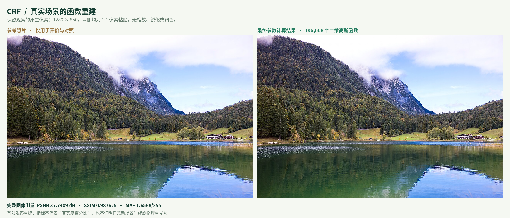

# CRF 真实场景画质交付：原尺寸计算与细节细化

日期：2026-11-22，北京时间。交付位置为原 `feat/crf-1.1-learnable-object-functions` 开发分支。`quality13` 是内部画质迭代编号，沿用已兼容的工程格式，不表示整个 CRF 1.3 或原 1.1 研究计划已经完成。

**本轮交付三份实际计算结果：山林湖泊、建筑街景、水果静物。** 它们已达到对应真实观察的高精度外观重建；全部像素由导出的连续函数参数重新求值。山林使用保留的 1280×850 观察直接拟合，未把原800像素结果放大后充当高分辨率重建。



## 直接打开本轮结果

从本仓库根目录运行：

```bash
git switch feat/crf-1.1-learnable-object-functions
cd graphics-editor/editor
npm ci
npm run dev:detail
```

打开 <http://127.0.0.1:4178/>。这是本轮三场景预览入口，默认先从函数参数计算1280×850的山林湖泊。支持场景切换、独立参考对照、固定局部、100%像素查看、1.5×函数重算、曝光、恢复、PNG和完整工程导出。此入口不需要Python、模型API或GPU。

可另外生成单文件便携预览：

```bash
npm run build:quality-review -- --output /absolute/path/CRF_Detail_Review.html
```

文件约31.5MB，包含三份完整数值参数，默认输出面板不使用任何预存成图。参考图片只在开启对照时解码，未传入计算Worker。单文件的Worker、帧摘要和竞态逻辑经过Node测试；当前执行环境无法完成新预览的实际浏览器交互验收，不能将这项写成通过。可优先直接查看下方原尺寸PNG与独立测量报告。

旧的 `npm run dev:quality` 仍打开800×531开发基线。运行 `npm run verify:detail` 会在 `quality-packs/` 生成三份 `.crf.json`，也可把它们导入旧工作台继续编辑；旧照片的分数不会套用到新导入的资产。

## 原尺寸质量

| 场景 | 实际尺寸 | 函数数量 | PSNR ↑ | SSIM ↑ | MAE /255 ↓ | P99通道误差 ↓ |
|---|---:|---:|---:|---:|---:|---:|
| 山林湖泊 | 1280×850 | 196,608 | 37.74091 dB | 0.987625 | 1.65679 | 14 |
| 建筑街景 | 667×1000 | 98,304 | 48.34254 dB | 0.992669 | 0.58542 | 3 |
| 水果静物 | 800×600 | 65,536 | 48.65744 dB | 0.991161 | 0.57572 | 3 |

- [山林原尺寸计算结果](editor/reports/quality13/fitting/alpine_hd/alpine_hd.png)
- [街景原尺寸计算结果](editor/reports/quality13/fitting/street/street.png)
- [水果原尺寸计算结果](editor/reports/quality13/fitting/orchard/orchard.png)
- [固定局部的参考／基线／最终结果](editor/reports/quality13/review/CRF_Detail_Comparison.png)
- [独立JavaScript输出的真实参考测量](editor/reports/quality13/independent-photo-audit.json)

三张图及九个提前冻结的局部全部通过[质量合同](editor/contracts/quality13.json)。合同在新拟合开始前独立提交，要求全图PSNR≥35、SSIM≥0.97、MAE≤3；另检查P99误差、较大误差像素比例和固定局部。评价没有再次缩小图像，也没有依据结果重新挑选ROI。

SSIM是参考相似性测量，**不能换算成“98.8%真实度”**。最大局部通道误差仍为山林63/255、街景24/255、水果31/255；高分不代表每个像素均正确。山林还有242/1,088,000个像素的某个通道误差超过32/255，街景与水果该数量为0。

## 算法改进及代价

之前的求解器在几何优化之前就用完所有函数预算，最后残留的小建筑边缘和细密纹理得不到专门分配。本轮预留25%的预算：先完成初始几何优化，再根据剩余误差分配细小函数，最后联合优化与颜色回修。导出后重新读取参数、计算PNG再验收。

| 相同最终函数预算 | 旧方法PSNR | 本轮PSNR | 增益 | MAE下降 | 旧方法／本轮拟合秒数 |
|---|---:|---:|---:|---:|---:|
| 山林196,608 | 37.20664 | 37.74091 | +0.53427 dB | 7.72% | 143.95 / 240.71 |
| 街景98,304 | 46.24924 | 48.34254 | +2.09330 dB | 19.93% | 80.24 / 145.34 |
| 水果65,536 | 47.36922 | 48.65744 | +1.28821 dB | 10.74% | 53.01 / 101.89 |

山林中误差>32的像素由490减至242，最大通道误差89减至63。同容量对照说明改进不只来自增加函数，但本轮进行了更多优化计算，不是等时加速比较。三场景并发在CPU上运行，时间包含共享宿主机竞争，不能视为用户M4或云端RTX性能。

函数为 `base + Σ RGB_i × exp(-q_i/2)`，使用有符号RGB系数和旋转椭圆支撑，sigma≥0.35源像素、q≤16。运行时从声明坐标求值，未读取原始RGB、残差贴图或预存成图。参考照片确实参与拟合，因此这些函数携带该照片的信息；这不是无参考创作或压缩优势证明。

最终JSON约16.01MB、7.93MB、5.24MB。更高质量付出了容量和计算成本。1.5×是连续函数重采样，不凭空恢复相机原图细节。山林的1280×850也是此前下载的观察尺寸，不是9528×6328相机原文件。

## 已验证的执行闭环

Python与JavaScript分别从序列化参数重算，三个原生RGBA输出逐字节一致。完整工程保存／重开、独立新进程重放、像素对齐的局部计算均相同。曝光实际改变输出；1280×850的完整2×请求超出既有4,000,000像素上限，按设计拒绝，没有放宽限额。[重放证据](editor/reports/quality13/runtime/verification.json)

GUI修复了旧参考图缓存跨工程复用的问题，也对参考加载期间切换工程、曝光debounce和旧请求晚到做了回归检查。新预览仅在参数摘要与实际原生RGBA摘要匹配时显示原生质量标识；编辑后明确显示当前输出未重新验收。

197项JavaScript测试通过；20项Python拟合与控制检查通过，其中quality12为9项、quality13为11项，详见[本轮验证汇总](editor/reports/quality13/verification-summary.json)。构建保留885个历史资产和901个公开资源的原字节，大小261,718,911字节，仍低于250MiB上限。较大新参数包保存在`quality-packs/`，不挤入旧托管资源包。[构建证据](editor/reports/quality13/build/build_verification.json)

[浏览器检查状态](editor/reports/quality13/browser-status.json)为未完成：开发服务器在所选浏览器环境不可达，失败页面访问又受到URL策略限制；没有绕过限制，也没有用单元测试冒充实际浏览器导出验收。已提供原尺寸图片和不需要浏览器的独立重算包。

## 重现拟合

Python依赖沿用`editor/requirements.txt`，并需要现有拟合器使用的C++编译器。每次尝试写入独立记录，不覆盖原报告；源图必须与冻结字节和尺寸匹配。仓库已包含已交付的第一次尝试记录，直接在新的检出中运行也会被拒绝。

从包含本轮最终提交的仓库根目录创建专门用于复现的独立worktree，再把其中的已交付参数和拟合报告改名保留。**以下两条`mv`仅在新建的`crf-detail-repro`工作树中执行，不在主工作树执行。** 这样保留交付证据，同时让拟合器的固定输出路径从空目录开始：

```bash
git worktree add --detach ../crf-detail-repro HEAD
cd ../crf-detail-repro/graphics-editor/editor
mv quality-packs quality-packs-delivered
mv reports/quality13/fitting reports/quality13/fitting-delivered

OPENBLAS_NUM_THREADS=1 OMP_NUM_THREADS=2 python3 scripts/fit_quality13.py alpine_hd \
  --work-dir "$PWD/fit-work"
OPENBLAS_NUM_THREADS=1 OMP_NUM_THREADS=2 python3 scripts/fit_quality13.py street \
  --work-dir "$PWD/fit-work"
OPENBLAS_NUM_THREADS=1 OMP_NUM_THREADS=2 python3 scripts/fit_quality13.py orchard \
  --work-dir "$PWD/fit-work"
npm ci
npm run verify:detail
```

三次拟合分别重新生成各场景的同容量基线、候选参数和报告；验证命令随后从新参数生成完整工程并独立重放。逐条执行，遇到错误先处理该错误，再继续下一步。

需要第二次尝试时，在上述同一隔离工作树中继续，并保留原`fit-work/`及新生成的报告和参数包。重试必须能读取同一工作目录内各场景的`baseline.asset.json`与此前的`attempt-01.asset.json`等候选资产；仅复制报告或换一个空工作目录不足以重试。例如重试山林：

```bash
OPENBLAS_NUM_THREADS=1 OMP_NUM_THREADS=2 python3 scripts/fit_quality13.py alpine_hd \
  --work-dir "$PWD/fit-work" --attempt 2 --skip-baseline
```

脚本先重新校验已有证据，再在冻结的尝试次数限制内计算新候选，并保留已验证结果中误差最低的通过项；已有尝试编号不能覆盖。当前交付三图均为第一候选通过，没有回退。拟合数学代码的原始版本保存在`reports/quality13/source-at-fit/`，后续源图绑定和重试保留最佳候选的控制修复另有回归证据；历史测量摘要不被改写。

## 仍需发展的能力

这次改善的是已有真实观察的函数重建，尚未实现从一句话生成任意新真实场景。场景语义、材质与光照尚未独立分解，移动光源不会自动产生正确的新阴影与反射。自然动态、真正的新视角、跨场景共享小模型、形式证明和自主程序RSI仍需各自的实现与证据。

RTX PRO6000／96GB没有在本轮接通或使用。更大GPU可以扩大拟合和渲染预算，但新场景生成能力仍需对象表示、关系约束和可组合成像模型，本轮没有把显存使用率当作画质证明。

本轮应按“可执行画质交付”审阅：先看原尺寸图片及细节，再运行同一份函数工程复算，再查看数值与来源。完整研究计划保持原有未完成状态。
