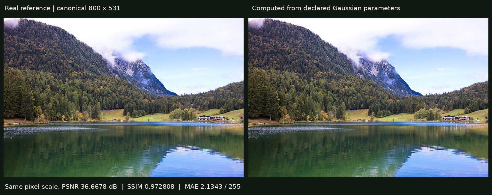

# CRF 1.1 · 真实场景质量交付

本轮版本：`1.1.0-experimental.2`。日期：2026-11-22，北京时间。

**这一轮把完整真实场景的重建质量接入了编辑器。** 现有 800×531 Alpine 参考在不缩小的条件下，导出参数重放获得 **36.6678 dB PSNR、0.972808 SSIM、2.1343/255 MAE**，三个预先冻结的细节区域也全部通过。实际工作台输出由函数参数计算；参考图片只在用户打开对照时单独读取。

这是逐参考拟合的连续函数资产。它证明了这张参考上的高质量重建和可执行编辑，不代表任意新场景生成、照片语义分解或完整 1.1 研究计划完成。`quality12` 是内部模块编号，不是产品 1.2。

## 先看实际结果



左侧为冻结参考，右侧为仅从声明函数重新计算的图像；两侧均保持 800×531 的像素比例。

- [原尺寸计算结果](editor/reports/quality12/alpine/reconstruction.png)
- [树林、水面、建筑的固定局部对照](editor/reports/quality12/review/fixed-detail-comparison.png)
- [绝对误差图，显示时放大四倍](editor/reports/quality12/review/absolute-error-times4.png)
- [真实参考质量报告](editor/web/assets/quality12/alpine.quality.json)
- [独立图片级复核](editor/reports/quality12/review/independent-audit.json)
- [Python / JavaScript 与独立重放报告](editor/reports/quality12/kernel/verification.json)
- [真实浏览器验证截图](editor/reports/quality12/browser/verified-workspace.jpg)
- [浏览器实际导出的五秒视频](editor/reports/quality12/browser/camera-browser.webm)
- [浏览器下载文件独立验证](editor/reports/quality12/browser/artifact-verification.json)

## 1. 打开本轮工作台

安装 Node.js 22 或以上，从仓库根目录运行：

```bash
git switch feat/crf-1.1-learnable-object-functions
cd graphics-editor/editor
npm ci
npm run dev:quality
```

浏览器打开 <http://127.0.0.1:4173/quality12.html>。首次打开会直接计算真实山林湖泊；无需模型 API 密钥、Python 或 GPU。保持终端运行，按 Control+C 停止服务。

端口占用时：

```bash
node ../tools/start11.mjs --quality --port 4174
```

页面的“对象函数”进入上一轮 `/studio11.html`，“完整案例”进入原 `/studio10.html`。原根页面、17 个入口和历史资产保持可访问。不要将上一轮手写山湖示例当成本轮画质结果。

## 2. 可以实际完成的操作

1. 默认在原生 800×531 尺寸计算，查看核对了参数摘要的基准分数。
2. 点击“显示参考对照”，查看同一位置的原图；山林、水面、岸边建筑均有固定 ROI。
3. 选择“重新计算 2×”，得到 1600×1062 的函数重采样。它不会凭空恢复原始摄影中未进入 800 像素参考的细节。
4. 调整曝光、对比度、饱和度，或在“可执行场景参数”中提交 JSON。修改后通过标识会改成“当前输出未重验”，历史基准分数不冒充新输出分数。
5. 保存完整工程，再打开时由参数重新计算；PNG 导出保存实际计算帧。反馈、视口和色彩设置可随工程保存。
6. 导出五秒镜头视频，120 帧、24 fps，逐帧重新求值并编码。动画是显式二维镜头推进，场景内容固定；没有声称学到了风、水、云等自然动力学。

## 3. 本轮改善了什么

上一轮水面只有 128×26 的训练像素和 1059 个参数，场景的大部分仍是手写形状。仅比较直接求值与缓存，无法证明真实画质。本轮使用整个真实观察，在连续二维高斯场中共同优化中心、尺度、方向和有符号 RGB 系数，并在**序列化之后重新渲染验收**。

颜色场为：

```text
C(u,v) = base + sum_i RGB_i * exp(-q_i(u,v)/2), q_i <= 16
```

每个高斯的八个标量为 `cx, cy, sx, sy, theta, R, G, B`。最小 sigma 为 0.35 源像素。运行时遍历有限支持域，Float64 累加，最后以 `floor(x+0.5)` 量化。没有原 RGB 贴回、颜色残差图、图像 base64 或源图网络请求。

同一次最终运行、同为 65,536 个函数，联合优化前后：

| 指标 | 固定几何颜色拟合 | 联合优化与回修 |
|---|---:|---:|
| PSNR | 29.5831 dB | **36.6678 dB** |
| SSIM | 0.892294 | **0.972808** |
| MAE /255 | 5.0471 | **2.1343** |

PSNR 增加约 7.08 dB，MAE 降低约 57.7%。增加了优化计算，不能把这组数据称为等时间加速。完整拟合在当前 CPU 环境耗时约 48.54 秒；耗时不是跨设备保证。

### GUI / Harness / Kernel 的连接

| 模块 | 当前实现 |
|---|---|
| GUI Service | 对照、真实编辑、原生细节、导出和持久反馈 |
| Agent Harness | `quality-harness12.js` 接受限定 `view/edits` 提案，冻结资产与契约、检查工程摘要，实际渲染后才返回候选；页面代码编辑用同一入口 |
| Compute Kernel | `crf-quality12.js` 为 Node 与浏览器 Worker 共用纯参数求值器，支持原生、ROI 和 2×计算 |
| 观察拟合 | Python 稀疏求解、自适应布局、解析梯度联合优化和颜色回修 |

LLM 可以只编写小份 JSON 场景参数而复用完整函数资产。以下是当前可执行范围；修改颜色和镜头不等于生成未观察的新物体。

```javascript
const Core = require('./web/crf-quality12.js');
const Harness = require('./web/quality-harness12.js');
const fs = require('node:fs');
const asset = JSON.parse(fs.readFileSync('web/assets/quality12/alpine.asset.json'));
const project = Core.createProject(asset);
const result = await Harness.propose({
  project,
  proposal: {
    view: {width: 800, height: 531, roi: [0, 0, 1, 1]},
    edits: {exposure: 0.25, contrast: 1.08, saturation: 0.9}
  }
});
// result.frame contains real computed RGBA8; result.run contains the checks.
// Changing view/edits does not grant a new reference-quality pass.
```

上例的 `await` 放在 async 函数内执行，或改写成 `.then()`。本轮没有接通新的付费 LLM 调用；上一轮真实 provider 接口仍保留，不能把本地参数编辑写成实际 LLM 自主创作证据。

## 4. 质量验收与边界

设计与门槛先提交为 `f66a3e35b1501ef0172b859351a42aa4c03230ee`。契约 `editor/contracts/quality12.json` 固定了参考文件摘要、800×531 尺寸、全图门槛与三个 ROI，拟合器不能降低阈值。

| 区域 | 实际 PSNR | 实际 SSIM | 实际 MAE /255 | 结果 |
|---|---:|---:|---:|---|
| 全图 | 36.6678 | 0.972808 | 2.1343 | 通过 |
| 山体与树林 | 34.5500 | 0.965694 | 3.1682 | 通过 |
| 水面与倒影 | 39.6449 | 0.965983 | 1.6502 | 通过 |
| 岸线与建筑 | 34.0575 | 0.967045 | 3.3712 | 通过 |

全图要求 PSNR≥32、SSIM≥0.95、MAE≤4；各 ROI 要求 SSIM≥0.90、MAE≤6。最大局部通道误差仍有 80/255，细小高对比边缘不保证完全还原。PSNR/SSIM 是此参考的有限测量，不是通用照片级质量证明。

另一张 512×292 落叶观察按同一拟合器得到 43.0374 dB / 0.987323 SSIM / 1.2496 MAE；它是补充复用检查，未冒充 Alpine 主契约的第二个通过样本。

### 参数容量

该资产包含 65,536 个函数、524,291 个标量。按 Float32 存储约 2.10 MB，是原 RGB8 字节量的 **1.65 倍**；公开 JSON 为 5,328,907 字节，约 **4.18 倍**。这轮取得的是重建质量、连续求值与可编辑性，没有压缩优势或小模型跨场景泛化的结论。

当前资产编码的是参考外观，包括原有光照、背景和倒影。对象语义、可组合场景关系、物理重光照、自然动态、WebGPU、形式证明和程序级自主 RSI 都需要后续独立工作，本次没有将它们标为完成。

## 5. 拟合自己的观察

仅浏览和渲染已交付资产不需要 Python。重新拟合需要 Python、NumPy、SciPy、Pillow 和 g++ / clang++：

```bash
python3 -m pip install -r requirements.txt
OPENBLAS_NUM_THREADS=1 OMP_NUM_THREADS=2 python3 scripts/fit_quality12.py \
  /path/to/your-photo.png \
  --output /path/to/your-function.asset.json \
  --report /path/to/your-function.quality.json \
  --preview /path/to/your-function.png \
  --budget 65536 --geometry-steps 100 --roi-profile none
```

`--roi-profile none` 明确表示此图不是冻结 Alpine 参考。不能给任意照片套用 Alpine 已通过的分数。为了在浏览器打开该资产，用 `Core.createProject(asset)` 和 `Core.serializeProject(project)` 保存完整工程，再点“打开工程”；原始 asset wrapper 与完整 project schema 有明确区别。

完整重训命令、来源链路、参数容量、失败基线与成本见 [FITTING.md](editor/reports/quality12/FITTING.md)。

## 6. 测试、构建与重放

本地已完成 **187 项 JavaScript 测试、9 项 Python 测试**。真实浏览器导出的原生 PNG、2× PNG、编辑后 PNG、重新打开工程后的 PNG，均与对应参数在独立 Node 内核重放的 RGBA **逐字节相同**；这些一致性数字与上方真实参考质量分开记录。

视频已独立解码为 VP9、800×531、24 fps、120 帧、5.000 秒。首个解码视频帧相对真实参考为 **33.9771 dB PSNR、3.2557/255 MAE**；有损视频不继承无损 PNG 的分数。镜头运动范围是声明的二维视口变化。

当前构建为 261,718,865 字节，低于 250 MiB 上限，余量 425,135 字节。901 个公共文件返回原字节，885 个历史基线文件和九个旧下载归档全部保留；完整数字见构建报告。

```bash
npm test
npm run test:v10
npm run test:v11
npm run test:quality
OPENBLAS_NUM_THREADS=1 OMP_NUM_THREADS=2 python3 tests/test_quality12.py
npm run verify:quality
python3 scripts/review_quality12.py
node scripts/verify_browser_quality12.cjs
python3 -m pip install -r requirements-build.txt
npm run build
```

构建加入 Zopfli 的无损 gzip 传输优化，在保留旧资源每个字节的同时为新增参数腾出空间。旧 250 MiB 限额未放宽。构建报告、原 URL 逐字节验证和九个旧归档恢复记录位于 `editor/reports/quality12/`；上一轮 `reports/v11/` 保留原证据。

本轮仍以分支和草稿 PR 交付：[PR #1](https://github.com/VIONWILLIAMS/complete-representation-functions/pull/1)。未合并主分支，也没有未经请求部署新公开网站。
