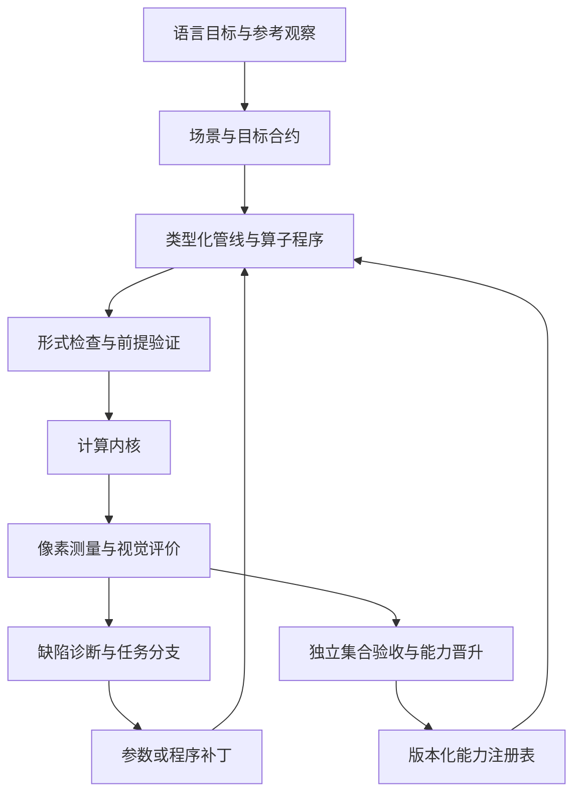

# CRF 1.1：计算内核、形式证明与 RSI 的一体化改进计划

**状态：研究与开发计划，待审阅；不是已实现的 1.1 交付报告。**  
**日期：2026 年 11 月 22 日，北京时间。**  
**产品基线：CRF 1.0。** 当前已交付源码与历史报告仍使用 `0.10.0`、`v10`、`v0.10` 等标识；按用户决定，将这批成果统一映射为产品 1.0，下一产品版本为 1.1。保留历史 schema 与证据，不重写旧报告。  
**审查基线：** `0b2fa1c044d073bd8349ef941cc1b213cbe1cfe1`。  
**当前站点：** <https://crf-street-04-lab-4d86.laterafter950.chatgpt.site>。本轮没有修改线上程序或调用付费生成 API。

## 1. 1.1 应交付的核心变化

CRF 的长期目标是：语言模型将视觉意图写成可执行、可编辑的函数程序，计算系统据此产生高质量图片和视频，并能通过反馈持续改进自身的生成能力。编辑器是模型与人操作这些函数、检查结果和管理能力版本的工作环境。

1.0 已经具备观察图像的高斯参数化、对象编排、像素求值、候选评价、失败保存和中断恢复。1.1 要把可以改动的对象扩展到管线与算子程序，并建立可信的改进判据。

**本版的三个主交付应相互依赖：**

1. **计算内核：**定义统一成像语义，修复颜色与覆盖度分开滤波等真实缺陷，统一拟合与渲染，并将接触、遮挡、背景补齐变成明确算子。
2. **形式证明：**建立小型类型化程序与可机器检查的性质，区分形式定理、有限实例检查、数值测量、模型意见和人工评价。
3. **受限 RSI：**依据失败证据产生参数、管线或程序补丁，在固定验收条件下比较、晋升、继承与回退。

首个端到端验收不是再增加一张好看的演示图，而是：**一个由系统实际提出的非参数程序变更，改善已存在的自然图像缺陷，在未参与该轮修改的来源组上仍有效，随后被新任务实际使用。**

形式证明约束程序的性质；像素与视觉评估检验效果；RSI 负责搜索可继承的改进。任何一项都不能代替另外两项。

## 2. 对当前源码和运行证据的复盘

下列结论来自现有源码与实际实验，而非假定下一版已经具备的能力。

| 现状与证据 | 对 1.1 的影响 |
|---|---|
| `web/crf-gaussian10.js` 先计算/滤波 RGB，再独立采样 alpha，最后相乘合成。 | 高频颜色与覆盖度相关时会产生边缘误差；需要联合预乘积分。 |
| alpha 仍是观察掩膜，缩小时采样上限有限。 | 高斯 RGB 不会自动恢复轮廓；要分开处理覆盖度、前景色污染和采样误差。 |
| 接触阴影是椭圆高斯，压暗此前的合成结果。 | 缺少承接面与接收对象，阴影可能错误作用于其他物品。 |
| 浏览器 `fitImage` 复用旧版拟合器；离线 Python 使用不同求解流程。 | 相同“导入/拟合”标签对应不同能力，必须明确后端或统一实现。 |
| 同 8,192 点、667×1000 街景：旧拟合器 28.1290 dB，新拟合器 26.0171 dB，颜色回修后 27.4757 dB。耗时也不同。 | 新求解器仍有质量回归；需同点数和同时间两套比较，不得仅增加点数宣布算法改进。 |
| `web/crf-verifier10.js` 是规则、像素与模型评价的组合，没有 SMT 或证明内核。 | 不能将现有规则检查直接改名为形式证明。 |
| 证据主要绑定场景、RGBA 字节和目标合约；未完整绑定宽高、色域、渲染器、参考图及 ROI。 | 同一证据可能被错误解释或复用，需完整的类型化证据清单。 |
| `server/generative10.mjs` 的计划解析清空部分语义约束；已有实验由外部补充合约。 | 必须开发真正的“语言目标 → 类型化目标合约”编译器。 |
| `task-runner10.js` 的候选只修改已有场景和已有操作；没有算子版本晋升。 | 当前是参数反馈循环，尚无程序级 RSI。 |
| 最后打磨中，水果三轮评分相同；陶器改善一次后停滞。 | 继续同类参数搜索不足以处理缺失的轮廓、微结构与光照能力。 |
| 发布包剩余空间为 73,691 字节。 | 在保留旧案例的前提下，必须先拆分应用、观察资产和实验档案的存放/加载方式。 |

1.0 仍有重要基础需要继承：17 个现有案例入口、所有历史资产、每个候选均实际评价、最优候选保留、合约冻结、未知用量记录、二进制存储、完整工程重放和五秒视频导出。17 个入口不等于 17 个独立来源，不能直接作为泛化实验的独立样本数。

证据索引见文末 B1–B7。

## 3. 范围与基本约束

| 约束 | 1.1 的执行解释 |
|---|---|
| 不做模型训练 | 不训练/微调语言或视觉模型，不更新跨场景共享的神经权重；允许逐观察高斯参数求解、程序搜索和明确标注的冻结模型推理。 |
| 以代码与高斯表示生成像素 | 最终 RGB 由显式函数和算子求值；不在验证路径中暗中贴回原始 RGB 位图。覆盖度、引用资产和补全来源必须声明。 |
| 以二维路线为主 | 保持二维高斯、覆盖函数、关系图和成像算子；不转向 Blender 或手工网格建模。 |
| 不减少既有案例 | 产品名、入口和数据格式迁移均向后兼容；旧 URL、原资源和历史实验保持可访问。 |
| 语义目标与验收对应 | 每个要求都有 requirementId、来源文本、可执行条件或明确的不可判定状态；不能静默丢弃不容易满足的要求。 |
| 承认观察边界 | 已观察、估计、合成和未知部分分别记录；合理补出的墙面不等于真实被遮挡墙面的恢复。 |
| 真正检查效果 | 参数合法、测试通过或形式定理成立，均不能直接推出照片真实感达标。 |

产品版号、文件格式版号和内核构建号分开管理。1.1 的工程可读取旧 `crf.gaussian_scene.v0.10`，新建工程使用明确的 1.1 schema；历史报告仍保留原标识。API 模型名固定并记录供应商返回标识；若服务没有提供权重修订号，该项保持未知，不承诺远端模型权重逐字节固定。

## 4. 总体架构与共同表示

两个入口继续汇合到同一套表示：

- 图片入口：观察、来源、覆盖度 → 逐图求解 → 局部函数资产。
- 语言入口：目标、物品、关系、编辑范围 → 类型化场景与任务合约。
- 共同路径：Scene IR → Pipeline IR → Operator IR → 参考或加速内核 → 像素与证据。

这里的 IR 是中间表示：模型可以生成和修改的、具有明确类型与执行语义的程序结构。



### 4.1 三种程序结构

**Scene IR：**对象身份、资产摘要、局部坐标、覆盖函数、外观函数、承接面、连接和遮挡关系、时间轨迹、来源与不确定性。

**Pipeline IR：**解码、覆盖、拟合、合成、阴影、补全、尺度过滤、输出编码等节点的有向无环图。每个节点有输入/输出类型、依赖、资源上限和影响范围。

**Operator IR：**有限、纯函数的数学程序。允许类型化数值运算、条件选择、有限邻域采样和有明确上限的归约；禁止把模型返回的任意脚本直接当作浏览器程序执行。

颜色仍以高斯场为主要表示。轮廓可由独立覆盖函数表达，关系由图表达，照明由成像函数表达。没有必要把每一种信息强行塞进同一种高斯参数。

### 4.2 两个不同的图

**TaskGraph** 记录本次任务如何执行：依赖、输入输出摘要、真实调用、失败、费用、取消和恢复。它决定哪些结果需要重算。

**VariantGraph** 记录程序如何变化：父版本、补丁、修改原因、性能、质量、证明状态和晋升记录。它支持不同长处的候选共存，不能被一条“总改最后一版”的链替代。

当前任务在开始时固定能力注册表快照；新能力晋升后，后续新任务才默认使用它。这样可以避免一个正在执行的任务在中途悄悄换掉内核。

自然语言到合约的语义对应本身需要检查，不能由证明器保证。保存原始目标、逐条需求追溯、第二次语义核对和未解析要求；即使形式命题已证明，也不能自动宣称它完整表达了用户意图。

## 5. 计算内核：优先修复成像语义

### 5.1 联合颜色、覆盖度与像素面积积分

当前近似容易混淆两个量：

`average(alpha × color)` 与 `average(alpha) × average(color)` 通常不相等。

例如，一个像素的一半为不透明白色，另一半透明且 RGB 为零：正确预乘贡献为 0.5；分别平均后相乘得到 0.25。这说明仅增加边缘羽化并不能修复所有色晕。

1.1 将像素定义为：在同一子像素位置求值前景颜色与覆盖度，先预乘并按关系合成，再对像素面积采样，最后进行明确的颜色编码。标准 source-over 预乘合成依据 R3；对上述误差的判断是结合当前源码作出的推导。

实施顺序：

1. 固定线性光、alpha、像素坐标、滤波足迹和输出量化协议。
2. 建立独立的 CPU 参考积分器及合成真值，不让候选求解器给自己制造真值。
3. 用同一采样点计算 alpha 与颜色，完成预乘联合积分。
4. 先隔离采样错误，再改进 matte 与前景色去污染，避免把所有问题归结为掩膜。
5. 在黑、白、彩色背景、细杆、斜线、亚像素位移和缩放条件下检查边缘。

参考数据分三种：解析或独立合成真值、经过收敛检查的数值参考、真实照片观察。ReferenceSpec 保存积分规则、收敛容差、截断、浮点配置和误差界状态；高采样参考仍可能有误差。只有严格推导的界才标为 bound，其余标为收敛测量。参考误差必须明显小于被检门槛。

### 5.2 分层高斯与预算化求解

低频结构、细节与边界可使用不同预算，但必须记录实际点数和成本。拟合目标、参考渲染和交付渲染应使用同一成像协议。

求解流程包含初始覆盖、颜色求解、几何/颜色交替优化、误差驱动 split/merge、回溯接受和最优状态保存。新增点必须从预设总预算中分配，不能无限加点换取“算法更优”的结论。

预算记录 requested/actual Gaussian count、覆盖与边界数据字节、全部函数参数字节、原生/评估尺寸、预处理和求解耗时。小物品实际点数可能低于请求值；辅助覆盖数据也计入表示成本。多个求解器的组合选择计入总预算，不能每个分支分别获得完整的比较预算。

1.0 旧求解器作为固定基线保留。交付选择器可以回退到较好结果，同时单独报告新算法独立胜率、回退比例与耗时。不能以“可以回退”掩盖新算法本身没有改善。

浏览器与离线执行器使用同一个 FitSpec，包括损失、色域、积分规则、参数界、seed 和预算。优先实现共享的可移植求解逻辑；如果存在独立 Python 参考实现，它必须有单独构建标识，并通过一致性测试，界面显示实际后端。旧 sRGB 系数不能逐项 gamma 转换后声称等价，因为非线性变换与求和不交换。

### 5.3 对象关系成为实际算子

增加 `attachedTo`、`supportedBy`、`occludes`、`shadowReceiver` 与局部锚点。至少完整实现：

- 信号灯与横杆：父子锚点保持连接，并检查实际像素贡献之间的连接路径。
- 水果与承接面：底部锚点随缩放、移动更新，阴影只作用于指定接收层。
- 删除信号灯：失去遮挡的区域由背景函数补齐，墙面接缝和低频照明继续贯通。

接触阴影先采用受承接面、接触线、光向近似约束的二维算子；其物理准确性保持未验证。照片中的真实照明不能由一个椭圆阴影完整恢复。

### 5.4 光照编辑的实际范围

分别保留观察辐射、颜色/反射率近似、低频照明、高光残差和阴影。每层注明观察或估计来源。单图的材质与照明分离本身存在不确定性；本版不承诺完整 GS-IR。

换色验收同时看目标色变化、纹理、高光、边缘带和保护区域。数学上的颜色乘法不一定可逆，特别是在 clamp 以后；“撤销”应恢复参数快照，不宣称反向调色能恢复所有被裁剪的信息。

### 5.5 时间与尺度

固定资产沿连续的图像平面轨迹求值；不能逐帧独立拟合后把闪烁归因于模型随机性。尺度测试覆盖 0.25×、0.5×、1×、2×和亚像素平移。时间测试需要坐标补偿后的残差、边缘跳变、重复/丢帧与时长检查。

五秒视频仍以二维运镜为主。真实三维新视角、未知背面和物体自然形变是独立能力，不纳入本版已完成承诺。

### 5.6 参考路径与加速路径

CPU 参考路径固定构建、采样、累计顺序和输出编码，负责重放及差分基准。WebGPU 路径使用 tile 分桶、局部累计、脏区更新和统一采样；其加速必须通过质量合同。

WGSL 浮点规范允许与 CPU 双精度不同的准确度和优化行为，因此不得承诺跨硬件 RGBA 恒等。GPU 用固定设备与数值容差验收，未通过时继续使用参考后端。实际设备是否支持 WebGPU，需在开发阶段探测并测量；不得仅凭 Mac 型号或浏览器名称认定支持。[R4]

严格局部保护适用于同一构建、采样和编码的参考路径。GPU 与 CPU 之间采用另一份符合性合约；GPU 若承诺编辑前后保护区逐字节不变，应保留已确认不受影响的 tile 字节，并另外验证脏区判断与完整重算一致。全局色调或采样协议变化使旧局部证明失效。扩大影响域也不能自动解除用户明确冻结的保护区；发生冲突时须报告合约冲突。

## 6. 形式证明：把命题、前提和实现范围明确下来

### 6.1 五类证据与声明分离

| 类别 | 例子 | 结论范围 |
|---|---|---|
| 形式证明 | 编辑不改无关 IR 字段；满足条件时合成有界。 | 指定语义、假设和可信基础下的定理。 |
| 有限实例完整检查 | 当前保护区所有像素相等；像素连接路径 witness 有效。 | 当前有限实例成立。 |
| 数值测量 | PSNR、边缘 MAE、尺度漂移、GPU 差分。 | 指定输入和协议下的测量。 |
| 模型感知判断 | 是否自然、是否出现拼贴感、语义是否符合。 | 模型意见。 |
| 人工评价 | 明确图像的盲评、用户验收。 | 实际人工判断。 |
| 参数声明 | 图层叫 apple、关系图写 attachedTo。 | 程序自述，不能替代图像中的事实。 |

形式状态使用 `proved / counterexample / unknown / not_applicable / invalid_evidence`。超时、未支持的算子、前提缺失和证书不存在均不能转换为通过。

### 6.2 六项优先性质

**P1：编辑字段不变性。** 为小型 Patch DSL 定义 `writes(op)`，证明不在写集合中的字段保持不变，并维持对象 ID 和引用约束。该性质属于程序表示，不自动推出像素不变。

**P2：局部影响范围。** 在依赖未改变、算子支撑域完整、保护区域与影响域不相交的前提下，证明影响域外输出不变；随后对当前帧进行全量保护像素检查。移动对象的影响域包括旧位置、新位置、显露背景、阴影和滤波边缘。无法保守界定时扩大到全画面或保持未知。高斯无限尾部必须明确截断或提供误差界，不能假定对象外严格为零。

**P3：预乘合成参考性质。** 使用一个独立固定点参考算子，例如 M=65535、0≤c≤a≤M，定义 source-over 的明确整数运算与舍入。证明输出有界、透明恒等、不透明覆盖和中间位宽安全。带舍入的合成不默认具有严格结合律；前后交换也不等价。限制适用于合成输入，不适用于每个有符号高斯系数。

**P4：关系与连接。** 对锚点约束做有限约束求解，并对实际贡献图保存、检查像素连接路径。对象标签存在或 parentId 存在，均不足以证明画面里已经连接。

**P5：晋升状态机。** 必需证据未知、缺失、陈旧或未跑封存检查时不能晋升；预算耗尽不能成为成功；恢复和回退保持明确的当前版本。协议中记录为通过，不等于所引用证据已经验证，必须经过证据检查器。

**P6：合约有效性。** ROI 非空、必需要求不丢失、前提具有可满足实例。在检查 P⇒Q 前，先确认 P 不矛盾。空集或矛盾前提产生的是无效合约，不能拿它当有效证明。

### 6.3 工具组合与可信基础

- **Lean：**离线/CI 建立少量纯函数与状态迁移定理。固定命题及其依赖定义；检查 axioms，拒绝 `sorryAx` 和未允许的假设。核心证明尽量不用扩张可信基础的捷径。
- **Z3：**处理具体有限约束、位向量模型和反例。明确区分信任求解器的 `solver_verified` 与由独立内核检查的 `kernel_checked`。
- **运行时检查器：**检查适用前提、证书版本、构建摘要、像素 witness 与实际输出。

Lean 官方说明“证明有效”与“命题是否是用户真正想表达的内容”是两件事；因此意图到合约的追溯关系同样需要审阅。[R5] 实数或固定 IEEE 浮点模型的定理，也不会自动成为任意 GPU shader 的正确性证明。[R4,R6]

本版不证明整个图形引擎，也不为“像真照片”建立虚假的数学定理。对高斯指数、截断、色域转换和数值积分，先建立误差测量；没有严谨误差界时标为测量结果。

增加 ImplementationRefinement 记录：`spec_only / implementation_tested / refinement_proved`、抽象语义摘要、解释器/编译器摘要、对应检查协议、报告/证明和 trustedComputingBase。1.1 默认交付的是“小型模型已证明、实现经过对应测试”，不是全栈已证明。证书绑定同一段代码不等于已经证明该代码符合 Lean 语义。

P3 的固定点参考用于声明的 SDR 预乘合成域。CompositeAdapter 必须规定曝光、色调映射、量化和合成的顺序；浮点/HDR 路径独立记录。不能为满足证明前提而悄悄截掉高动态范围，也不能让固定点证明越过未经验证的适配器。

### 6.4 完整证据绑定

每个 EvidenceBundle 绑定：意图、合约、前后场景、补丁、资产、管线、算子注册表、渲染器构建、验证器构建、参考图、ROI、基准集合、采样与色彩配置、实际帧和模型评价图片。

FrameDescriptor 至少含：宽、高、通道顺序、色域、alpha 约定、采样配置和解码后的像素字节。不能只对一段 RGBA 字节取摘要。

证书还应包含命题、前提、证明工具版本、可信基础、证明文件、检查运行记录、适用范围和反例。摘要只能绑定内容，不能保证内容真实；外部 JSON 自称 `proved` 不得直接晋升。人工评价来源、图像与问题也应核对，模型输出 reviewer 字符串不能成为独立人评。

## 7. RSI：从修改一张图，发展到改进可复用程序

### 7.1 四级改进范围

| 层级 | 可改变对象 | 1.1 范围 | 成果判定 |
|---|---|---|---|
| L0 | 场景参数、局部高斯系数、预算分配 | 必须 | 当前任务改善，本身不算程序 RSI。 |
| L1 | 管线选择、顺序、依赖和局部重算策略 | 必须 | 新管线在新任务中仍有效。 |
| L2 | 受限 Operator IR 的算法结构 | 必须完成至少一条真实闭环 | 程序摘要变化、通过检查、跨来源收益、晋升并复用。 |
| L3 | 诊断提示、分支选择、修复策略与预算分配 | 离线实验 | 提高后续搜索能力，暂不承诺开放式自修改。 |

改变颜色常数、阴影强度或其他实例参数归为 L0；选择已经存在的算子是 L1；L2 必须发生可检查的程序结构变化。人工写好的内核升级与系统实际提出的程序补丁分别记录，不能把前者算作 RSI 自动发现。

### 7.2 循环的运行方式

1. 编译目标并检查目标可执行性；保留未支持或不明确的要求。
2. 计算初始图、像素误差、边界、贡献与关系证据。
3. 诊断失败属于参数、表示、算子、数据不足还是合约冲突。
4. 在允许范围内建立任务分支，提出参数、管线或算子补丁。
5. 依次进行编译、便宜的前提检查、形式义务、局部数值测试、全图回归、视觉评价和成本检查。
6. 保留满足硬约束的少量互补候选，如边缘较好、速度较快、内存较低；分数打平不覆盖已验证版本。
7. 只用选择集决定候选；冻结程序、合约、适用域和参数策略后，最终候选执行本次发布唯一正式封存检验。
8. 晋升为带适用域的新能力版本；新任务加载该版本并记录实际使用。
9. 未通过则保留旧版本与失败原因；问题需要新数据时启动证据获取任务，需要未知能力时明确停止。

形式义务先于昂贵渲染，局部检查先于完整基准，有助于把推理投入具体失败。该设计借鉴 AlphaEvolve 的可执行程序搜索与评估级联、DGM 的程序血缘及经验验证、GEPA 的执行轨迹反馈和互补候选。[R8–R10]

### 7.3 首个 RSI 案例

首先人工修复已经识别到的联合积分缺陷，建立正确的参考语义。然后针对仍存在的自然物品边缘和缩放误差，让系统探索**有限预算下的自适应采样或局部高斯细化策略**。

提议器可以看到开发集的真实失败与误差图，但不能修改参考积分器、目标门槛和封存样本。候选必须同时控制误差、锐度和资源用量，防止仅靠模糊或无限加点降低某一个指标。

最低成功记录包括：程序前后差异、真实模型提议、证明/反例、开发与选择结果、一次封存检验、晋升版本，以及另一个新任务实际调用该版本的运行记录。只修复人为植入的小错误可验证管线，不足以完成自然图像上的 RSI 效果验收。

记录 `executedOperatorHash`、真实调用次数、作用区域、fallback 次数与缓存来源；新代码必须参与当前像素计算。人工种子实现于自动搜索前冻结，之后的人工改动另开基线。候选的适用谓词、最低覆盖率、目标指标和允许回归也须在封存前固定，不能看到失败后缩小适用域。

### 7.4 固定评价边界

同一轮改进不能同时修改负责评判自己的合约、验证器、参考渲染器或晋升规则。若发现验证器缺陷，创建独立的新验证器版本，保留旧结果并重新开始可比较实验。

每轮模型和推理档位、输入图、请求/返回、已知用量和结果未知的调用均记录。采用分阶段预算：局部诊断不必总用最大推理，程序补丁和反例分析可获得更高预算。对高推理档输出截断要重用已有图像和结果，避免重复生成。供应商未知用量不按零计算，也不宣称本地 token 计数等于绝对账单上限。

所有层级和子任务共用持久 runBudget：请求、已知/保留 token、检索、拟合/渲染时间、证明时间、候选数、重试与分支深度。L0→L1→L2、恢复和子任务均继承剩余额度。启动候选前为必要评价预留预算；不足时保留未验收状态，不晋升。该总账是执行协议的一部分，不能由候选改写。

## 8. 编辑器如何承载有效运行的程序

### 8.1 交互结构

沿用原有案例列表与中心画布，新增/重构四个工作区：

1. **目标与函数：**自然语言目标、物品树、关系图、函数参数、观察/推断标记。
2. **证明与测量：**每项命题、前提、证明范围、反例、像素热图、边缘带、模型意见和人工评价。
3. **改进任务：**任务依赖、正在修复的缺陷、L0/L1/L2 分支、成本、停止原因和可恢复状态。
4. **能力版本：**程序差异、父版本、适用域、封存结果、晋升、回退与新任务使用记录。

点击一个失败项，应定位相应画布区域和函数节点，并能启动有明确作用域的修复。修改画面后，与旧像素或旧构建不匹配的证据立即变为陈旧，不能保留绿色通过状态。

### 8.2 首条用户流程

用户输入“把墙改成蓝色，去掉正面行人信号灯，保持灯杆、横杆和其他窗户”。编译器输出目标、对象范围、删除区域、保护区及背景补齐要求。

内核先渲染，检查器核对保护区、连接、边缘和补齐接缝。若边缘带失败，循环先尝试合适的参数/覆盖修复；停滞后提出管线或算子候选。候选经检查后才替换当前结果；程序级晋升还须通过跨场景验收。

第二条流程是“替换苹果为梨并保持桌面接触关系”；第三条是建筑/植物细边的五秒缩放运镜。它们分别检查局部编辑、关系保持和时序尺度稳定。

### 8.3 执行服务

浏览器负责交互、轻量前提与像素检查、参考/加速预览。托管 API 负责模型代理、任务协调与结果查询。Lean/Z3、新算子检查和较重求解在独立执行器或 CI 中运行，不能假定现有站点 Worker 可以启动这些程序。

计划接口：

```text
POST /api/crf/v1.1/jobs                 建立真实异步任务，返回 jobId
GET  /api/crf/v1.1/jobs/{id}            状态与事件游标
POST /api/crf/v1.1/jobs/{id}/actions    取消或显式恢复
GET  /api/crf/v1.1/artifacts/{digest}   当前权限内的参数、图像与证据
POST /api/crf/v1.1/proof-jobs           新程序的证明/约束检查
```

任务采用持久日志、执行租约、幂等请求键和内容摘要缓存。页面关闭不能抹掉已执行结果；远端调用结果未知时，恢复流程先保留未知状态，不假设请求没有发生。浏览器的本地存储不应被描述为后台持续执行器。

租约使用递增 fencing token；晚返回的旧执行者不能覆盖新尝试。注册表晋升采用 expectedRegistryRevision 比较交换，证据清单与当前版本指针原子提交。增加“双执行者、旧执行者晚返回”的故障测试，验证只有一次有效晋升。该机制不承诺远端供应商请求恰好执行一次。

ArtifactStore 先提供真实磁盘实现与固定接口；托管发布需选定并接通持久对象存储。旧资源可通过相同 URL 的解析层继续提供，要求字节一致、权限范围不变。没有接通的服务要显示不可用，不能用演示状态代替执行。

Z3 的浏览器包需要 WASM、线程及 SharedArrayBuffer 环境；本版不默认将其塞入页面。[R7] 不可用时允许普通预览，但新程序的证明保持 unknown，不能晋升。

## 9. 评价数据、对照实验与建议验收门槛

以下数值是**待审阅的工程目标，尚未测得**。第一阶段用开发基线确认计量协议和可行性，再冻结合约；不得看过封存结果后降低本轮门槛。

### 9.1 数据组织

- 原有 17 个案例入口作为持续回归集，全部保留。
- 新参考采集延续十轮检索路径，目标至少 60 个有效候选来源；去重与筛选后形成 60 个独立来源组，不足则补充，不能用同图裁剪凑数。
- 五类来源：城市建筑、自然风景、果实与植物、陶器与日用品、细杆/栏杆/织物边缘。
- 按来源/物品身份分为 30 组开发、15 组选择、15 组封存；相同原图、近重复图和同一物品的派生图不得跨组。
- 合成测试独立产生几何/覆盖真值，覆盖硬边、透明边、彩色边和尺度，不使用待优化内核生成自己的真值。

对于重建任务，锁定后的拟合程序当然可以读取目标照片；封存是限制程序提出者反复根据该集合调算法。若某次封存失败被用于继续改程序，该集合必须重新归类，并建立新的封存版本。

边缘 MAE 分三个协议：观察重建使用原照片；受控编辑使用独立前景、覆盖与背景真值；自然编辑没有已知目标 RGB 时只报告保护区、接缝、目标色和合理性。边缘带在最终输出坐标中，由冻结参考轮廓或独立标注构造，不能由候选自己的 alpha 决定测量区域。

### 9.2 建议门槛

| 项目 | 门槛类型 | 1.1 建议目标 | 解释 |
|---|---|---|---|
| 历史兼容 | 发布必需 | 所有旧入口/资源保留；兼容路径固定参考重放一致。 | 与新内核质量改进分别统计。 |
| 局部编辑 | 发布必需 | 严格参考 profile 内，声明影响域外 RGBA 差异为 0。 | 包括阴影、滤波与显露背景依赖；不能解除用户保护区。 |
| 边缘质量 | 发布必需 | 有真值任务的预注册 1–3 px 边缘带 MAE 中位数下降至少 20%，轮廓偏移和梯度误差不回归。 | 用成对逐例结果报告；自然未知编辑不适用该真值门槛。 |
| 重建求解 | 发布必需 | 固定实际点数下新求解器 PSNR 中位数提升目标 0.5 dB；单例退化超过 0.1 dB 判失败并回退。 | 回退后的不回归与新算法胜率、成本分开。 |
| 算力公平 | 发布必需 | 点数 8,192/32,768/65,536；另做 20/60/180 秒预算曲线。 | 实际点数、辅助数据和所有分支成本同时记录。 |
| GPU 符合性 | 启用GPU必需 | 建议起点：支持域内最大通道差≤2/255、P99≤1/255；另报告线性域误差。 | 实测合同；M0冻结，跨设备不外推。 |
| 预览速度 | 宣称实时加速必需 | 1024×768、≤65,536 点、依赖展开后脏区≤25%，目标设备预热后更新 P95≤100 ms。 | 从编辑事件到新帧呈现，含编译/队列/传输/GPU；验证更新时间另列。 |
| 短视频 | 发布必需 | 5 秒、24 fps、120 帧；帧序正确；尺度/时间误差满足预注册协议。 | 2D 运镜，不代称 3D 新视角。 |
| 形式层 | 发布必需 | 六类义务真实实现；P1/P2/P3/P5 至少各有核心已检查定理，P4/P6具有限实例检查；反例/超时正确处理。 | 无 sorry、公理明确；模型证明与实现测试分开。 |
| RSI | 发布必需 | 至少一项真实 L2 结构变更；目标误差相对固定1.1内核中位数改善目标10%，旧集不超回归容差，成本不超预算，新任务实际继承。 | 适用域、最小效果量、回归与fallback规则在封存前冻结。 |
| 新构图真实感 | 宣称照片质量提升必需；技术版诊断 | 预注册至少20个独立目标、每组至少3名有效人工评审；场景级成对胜率目标≥60%，同时要求区间证据支持改善，平局另报。 | 区间按场景/来源分组计算；样本不足或区间无法区分时为未确定，不由模型代填。 |

对于基线误差近零的样本，比例提升不稳定，应采用事先冻结的绝对误差容差。所有质量统计同时报告每例结果、分布、成本和适用域；小样本收益不能外推到任意图片。

### 9.3 对照与消融

采用五组核心对照：1.0+现有参数循环；1.1 固定内核/管线；1.1+L0；1.1+L0/L1；1.1+L0/L1/L2。同 prompt、同参考、同分辨率和可比预算，至少三条提议轨迹，若供应商不支持固定 seed 则明确记录不可控因素。单独禁用 L2 时保留相同管线与输入，隔离真实程序变更的贡献。

另做两类分离实验：

- 固定内核增加推理预算，测量“更多推理”本身的边际收益。
- 禁用新算子或晋升能力，测量真实 RSI 收益与人工内核升级的区别。

形式层主要看违规补丁拦截、无效证据拒绝和保护性质，不把它的贡献伪装成审美分数提高。

## 10. 必须出现的失败演示

1. 相同 RGBA 字节但宽高/色域不同，旧评价失效。
2. 换墙色误伤信号灯，保护区检查失败。
3. 移动灯后声明仍连接，实际锚点或贡献路径检查失败。
4. 阴影改变了对象 mask 外像素，影响域正确扩大。
5. 使用旧 shader 的证明/测量为新 shader 背书，证据失效。
6. ROI 为空、前提矛盾或必需要求被删，合约无效。
7. 证明超时、最后候选未评价、封存未执行，均不能晋升。
8. 模型自称独立评审，不能变成人工评价证据。
9. 候选试图降低自己的门槛，产生新合约且原比较失效。
10. 程序在开发集更好、封存集更差，保留旧能力。
11. 取消或断线后恢复，不重复已完成的昂贵步骤，未知调用不消失。
12. 改善只来自更大点数、模糊或隐藏原图残差，无法通过对应对照。
13. 旧执行者晚返回、取消后提交或并发晋升，不能覆盖有效版本。
14. 未使用新算子、只修改摘要或缓存仍指向旧程序，不能计为 L2 成功。

## 11. 开发模块与现有代码的衔接

所有下列新路径都是计划，不表示文件已经实现。

| 工作包 | 计划模块 | 从当前哪里演进 | 主要交付 |
|---|---|---|---|
| W0 基线与版本 | `versioning/`、`benchmarks/manifests/` | package、旧 schema、历史报告 | 1.0映射、17入口快照、统一色域/指标协议。 |
| W1 语义合约 | `contracts/intent11`、`core/scene-ir11` | generative10 的计划与约束 | 需求追溯、单位、对象关系、未知要求。 |
| W2 像素内核 | `core/reference11`、`coverage11`、`gaussian-field11` | crf-gaussian10 | 联合积分、覆盖边界、统一输出语义。 |
| W3 求解与关系 | `solver/fit11`、`core/relations11`、`completion11` | Python拟合、边界管线 | 同预算求解、承接面、连接和背景函数。 |
| W4 证明与证据 | `proof/spec/`、`proof/lean/`、`proof/smt11`、`evidence/` | crf-verifier10 | 定理、前提、反例、完整绑定与证据失效。 |
| W5 执行设施 | `runtime/jobs11`、`artifact-store11`、`proof-worker11` | task-runner10、storage10 | 真异步、恢复、资源引用、真实证明执行器。 |
| W6 RSI | `rsi/controller11`、`pipeline-ir11`、`operator-ir11`、`registry11` | 已有候选与反馈循环 | 程序补丁、双图、档案、晋升、继承与回退。 |
| W7 编辑器与加速 | `web/editor11`、`core/webgpu11`、`render-worker11` | editor10、render-worker10 | 画布与证据联动、真实任务展示、合格加速路径。 |
| W8 评价与交付 | `benchmarks/runner11`、`ablation11` | 现有实验脚本与报告 | 封存实验、案例、视频、完整工程和未通过项。 |

### 11.1 核心接口

```text
compileIntent(text, references, capabilities) → IntentContract + unresolvedRequirements
compileScene(scene, registrySnapshot, renderProfile) → CompiledScene + obligations
fitObservation(input, fitSpec, budget) → Asset + FitEvidence
render(compiledScene, renderProfile) → Frame + ContributionMap + Diagnostics
verify(candidate, contract, evidenceContext) → TypedEvidenceBundle
proposeRepair(failures, scope, archive, budget) → ParameterPatch | PipelinePatch | OperatorPatch
evaluateVariant(variant, frozenEvaluationSpec) → EvaluationRecord
promote(variant, checkedEvidence, policy) → RegistryRevision | Rejection
```

外部模型建议必须经过编译、类型和作用域检查才能进入这些接口；render、verify 和 promote 不接受模型任意填入的通过状态。

## 12. 六个里程碑与退出条件

| 里程碑 | 主要工作与依赖 | 可运行的退出条件 |
|---|---|---|
| M0 冻结基线与计量 | W0；W1、W4、W5 的接口准备。 | 基线可重放，版本映射明确，目标/色域/预算协议冻结；资产存储容量方案实际可行。 |
| M1 首条联合闭环 | W1、W2、W4、W5 最小实现。 | 从“换墙色”到真实渲染、保护区检查、至少一个已检查定理/反例，直接在编辑器中显示。 |
| M2 内核与关系改善 | W2、W3；W4扩展。 | 边缘、多背景、连接、补齐、同预算求解达到目标；不回归旧案例。 |
| M3 程序级 RSI | W6 依赖类型化内核、证明与持久执行器。 | 真实 L2 补丁→检查→选择集评估→staged能力→新任务试用完整运行；失败能回退，不消费正式封存集。 |
| M4 完整编辑器与性能 | W7；与 M2/M3 部分并行。 | 案例、候选、证据、版本与任务可操作；支持合格GPU或明确CPU路径；导出/恢复有效。 |
| M5 独立验收与发布 | W8；依赖前述里程碑。 | 最终程序冻结后一次正式封存，通过后promoted并在新任务实际使用；消融、旧资源、导出与未通过项完整。 |

W1、W2、W4、W5 可在 M0 后并行，但必须在 M1 汇合到同一个真实用户操作，避免各自做出无法连接的模块。研究失败不能通过更改里程碑名称绕过。

1.1 正式效果验收需要同时满足：内核改善、证明层有效、真实程序 RSI 收益、编辑器可运行。若只完成了执行设施而未出现跨任务收益，交付状态应是 1.1 候选版，明确标注能力改善未通过。

技术版通过不自动代表照片质量或实时加速通过；这两种产品主张必须分别满足表中的对应门槛。M3只运行开发/选择集上的试晋升，M5才运行本次发布的正式封存。不得用同一封存集在两个阶段反复选赢家。

## 13. 本版之后的边界

本计划不会把表示能力误认为内容生成能力。二维高斯可以承载细节，但任意新场景的未见结构、材质与照明仍需要生成先验。可在不训练模型的前提下，单独评估现成冻结模型推理；它们的输入、输出、职责、许可证和实际运行证据必须公开记录。

真实新视角、完整物理逆渲染、通用无参考照片生成及开放式 L3 自修改，保留为后续研究。1.1 的关键贡献应是：**在明确适用范围内，系统能改进可执行的生成程序，并让新任务实际继承经过验证的能力。**

## 14. 依据与参考

### 基线证据

- B1：`reports/v10/kernel/evidence-summary.json`，拟合回归、兼容性和采样机制结果。
- B2：`web/crf-gaussian10.js` 与 `scripts/fit_gaussian10.py`，当前成像与拟合实现。
- B3：`web/crf-verifier10.js`，检查类别、证据绑定及当前证明能力边界。
- B4：`web/task-runner10.js` 与 `server/generative10.mjs`，当前反馈循环和语义编译边界。
- B5：`reports/v10/generation/polish-v3/` 与 `reports/v10/release_evidence.json`，真实候选、失败、调用及用量。
- B6：`reports/v10/build_verification.json`，发布资源与空间余量。
- B7：`reports/v10/browser/`、`reports/v10/release_checks.json`，实际导出、重放与回归检查。

### 官方主源

- R1：[GaussianImage](https://arxiv.org/abs/2403.08551)，二维高斯表示与累计求和。
- R2：[Mip-Splatting](https://niujinshuchong.github.io/mip-splatting/)，像素足迹与尺度过滤；完整方法还包括三维平滑。
- R3：[W3C Compositing and Blending](https://www.w3.org/TR/compositing-1/)，预乘颜色与 source-over。
- R4：[W3C WGSL](https://www.w3.org/TR/WGSL/)，浮点准确度、重关联与融合规则。
- R5：[Lean：Validating a Lean Proof](https://lean-lang.org/doc/reference/latest/ValidatingProofs/)，命题、证明、axioms与重检查。
- R6：[Z3 IEEE Floats](https://microsoft.github.io/z3guide/docs/theories/IEEE%20Floats/)，浮点逻辑及其与实数代数的差异。
- R7：[Z3 JavaScript API](https://z3prover.github.io/api/html/js/index.html)，WASM与线程运行要求。
- R8：[AlphaEvolve](https://arxiv.org/html/2506.13131v1)，可执行程序搜索、评估级联与候选档案。
- R9：[Darwin Gödel Machine](https://arxiv.org/html/2505.22954v3)，程序自修改与经验验证；不提供每次修改必然改善的定理。
- R10：[GEPA](https://arxiv.org/html/2507.19457v2)，冻结权重下的轨迹反馈、模块修订与候选选择。

以上研究提供机制参考，论文中的速度或基准增益不作为 CRF 已实现或必然达到的性能。所有建议阈值、模块和里程碑以本文件的“计划”状态为准。
