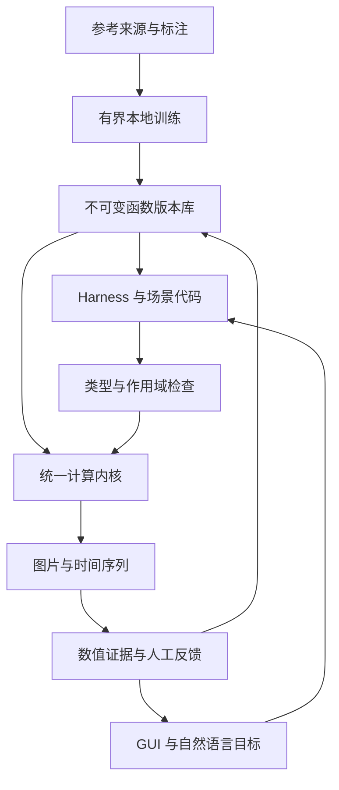

# CRF 1.1 独立升级分支：可学习对象函数、统一计算内核与图形编辑闭环

**文档状态：设计评审完成，随独立设计提交冻结；冻结时尚未开始新增模块的实现。**  
**日期：2026-11-22。**  
**开发分支：`feat/crf-1.1-learnable-object-functions`。**  
**本分支起点：`a04e7a0e85f997b8040bff85783dda89a768e928`。**  
**产品基线：CRF 1.0；历史源码版本 `0.10.0 / v10`。**  
**实施原则：先提交本设计，再开发与验收，最后提交 GitHub；保留历史计划和旧程序。**

## 1. 目标、授权变化与交付边界

本升级把“参考学习 → 可调用对象函数 → LLM 编写场景程序 → 统一内核求值 → GUI 反馈 → 图片与视频输出”接成真实工作流。对象函数同时支持显式数学函数、已有二维高斯资产和本地训练的小型条件神经函数。编辑器管理函数的身份、版本、来源和适用范围；Harness 组织目标、生成、检查和反馈；计算内核执行明确的像素语义。

本次用户明确要求引入本地小型神经网络。因此，原 `CRF_1_1_Implementation_Plan.md`、`CRF_1_1_Execution_Plan.json` 和 `graphics-editor/AGENTS.md` 中“不做模型训练 / modelTraining:false”的约束，在**本独立分支的新学习对象函数工作流**中作以下修订：允许对用户提供或实际检索获得的参考数据进行有界小模型训练，允许生成程序调用明确声明、版本固定的神经函数权重。原计划、旧报告和 v10 接口保持原有语义，不回写为“历史上已经允许或完成训练”。不训练基础语言模型，不默认调用未授权的付费服务。

本分支不是原 1.1 全部 M0–M5 的完成声明。原计划要求的 Lean/Z3 证明、真实 L2 程序 RSI、封存集跨任务收益和合格 WebGPU 加速，仍需分别实施和验收。这里交付的是可运行的**可学习对象函数技术分支**：真实训练、函数版本库、受限场景代码、共享 CPU 内核、GUI/Harness 操作、确定性二维时间轨迹和真实导出。

### 1.1 本分支必须完成

1. 显式函数、神经函数、二维高斯适配器使用同一函数契约，进入同一场景及合成路径。
2. 参考输入经过真实解码、来源记录、预处理和实际训练，产生可加载、可执行、可导出的权重及训练报告。
3. 场景固定引用函数内容版本；函数的改变产生新版本，旧工程继续重放旧版本。
4. LLM 获得轻量函数目录，返回有界、类型化 JSON 场景程序或补丁；与 GUI 使用同一个检查及修改入口。
5. 用户可以查看参考、训练进度、函数实例、源程序、渲染结果、诊断、反馈和历史版本，并导出完整工程、PNG 和实际视频。
6. 对直接求值和缓存求值进行真实差分、计时和成本记录；失败、取消、超时及未知状态得到保留。
7. 保留既有 17 个案例入口的产品兼容目标、旧 URL、资源和历史报告。验收清单区分“案例入口数”“HTML 文件数”“资产数”，不将它们混为一项测试数量。

### 1.2 本次不能据此宣称的能力

| 能力 | 本分支的真实范围 | 更强主张需要的额外工作 |
|---|---|---|
| 参考学习 | 坐标到 RGB 的实际学习；可共享解码器并按有限实例条件调用。 | 具有可解释语义控制、能生成未见对象的类别模型与独立来源检验。 |
| 代码生成图片 | LLM 编写受限场景程序，调用显式或版本化神经函数。 | 任意自然场景的照片质量需要更丰富表示、数据和独立视觉评估。 |
| 视频 | 同一对象函数沿明确二维轨迹求值并编码。 | 学得的真实运动、形变、流体动力学和未知视角。 |
| 计算优化 | 编译、支撑域裁剪、权重预处理和程序生成的场缓存。 | GPU 加速、通用增量计算或所有设备实时保证。 |
| 验证 | 类型、范围、资源、摘要、有限样例和数值测量。 | 形式证明及实现精化证明。 |
| 自我改进 | 人工反馈、场景补丁和模型训练分别留痕。 | 满足原计划定义的 L1/L2 程序修改、固定评估、独立验收、晋升及新任务实际继承。 |

小网络完成一次拟合，不等于学习到“水”“云”或“山”的完整生成概念。函数名字、对象标签、模型自评分也不能作为该概念已出现在像素中的证据。强内核提供可执行性、控制与测量；视觉语义、审美和真实感仍需要专门的数据、先验与反馈。

## 2. 实际代码基线与衔接点

已完整阅读两级 `AGENTS.md` 以及两份原 1.1 计划。本设计不增加 CRF 理论核心 DSL 域，不修改 `machine/domain-registry.json` 的域定义；下面的 JSON schema 属于图形应用的执行协议。

| 当前文件 / 模块 | 源码实际提供的能力 | 本分支衔接方式 |
|---|---|---|
| `editor/web/crf-core.js` | 旧版 UMD 模块、场景参数、轨迹与基础检查。 | 沿用浏览器和 Node 共用的 UMD 组织方式；不改变旧入口执行语义。 |
| `editor/web/crf-gaussian10.js` | 显式各向异性高斯 RGB、可选 RLE alpha、仿射编辑、线性光合成；当前颜色和覆盖独立过滤。 | 新增高斯资产包装器，在新路径按统一采样语义求值；旧 v10 渲染器保留。 |
| `editor/web/crf-generative09.js` | 解析图像平面生成、显式对象、外观统计与共享描述子。 | 可复用表示经验及对照案例；其 `learnAppearance` 不标为本次新增神经网络训练。 |
| `editor/server/learning08.mjs` | `researchGaussian08` 实际检索/收集参考，`learnSemanticDescriptors08` 请求语义描述。 | 复用检索链路，真实服务未接通时显示阻塞；新增本地训练入口。 |
| `editor/web/learning-client08.js` | 参考解码、来源及提交图像摘要、拟合/描述调用和进度。 | 保留原工作流；新页面独立管理神经学习过程与结果。 |
| `editor/server/generative10.mjs` | 原生解析场景或参考高斯编排；返回 `modelTraining:false`。 | 新建 v11 函数目录感知的 provider；旧 API 语义不变。 |
| `editor/web/task-runner10.js`、`crf-verifier10.js` | 参数候选与规则/像素/模型评价、有限持久化。 | 新 Harness 显式绑定 v11 场景和函数摘要；不把旧修复循环称为程序 RSI。 |
| `editor/web/crf-video09.js` | WebCodecs 编码与 WebM 封装、固定帧时间戳、实际编码器能力检测。 | 直接复用 `CRFVideo09`；新内核提供逐帧求值函数。 |
| `editor/package.json`、`scripts/build_server10.cjs` | 无前端框架，Node ≥20，`esbuild`/`pngjs` 开发依赖及打包路径。 | 新增少量 JS/HTML/CSS；调整新版本构建容量，不批量更写历史资源。 |

本分支建立前，根任务已实际运行基线：`npm test` 52/52、`npm run test:v10` 64/64、构建通过。基线打包剩余 73,691 字节；此次核验涉及 15 个 web HTML 和 885 个打包资产的字节保留。这些是工程基线结果，不是新学习系统或 1.1 完成证据。后续报告必须保存自己的命令、环境和结果。

## 3. 最小体系结构与职责



| 部件 | 负责 | 不得冒领的职责 |
|---|---|---|
| GUI Service | 展示真实状态、编辑参数/场景代码、参考输入、训练/渲染调度、导出、版本比较。 | 不在 UI 中伪造训练、模型调用或通过结果。 |
| Agent Harness | 固定输入和能力目录、请求程序/补丁、验证作用域、实际渲染、记录调用与失败、反馈。 | 不让候选改写函数注册表、验证器、评估条件和自身账本。 |
| 函数库 | 保存可执行函数、权重、类型、来源、版本、适用域和证据引用。 | 注册成功不等于泛化成功或正式能力晋升。 |
| 训练器 | 有界样本处理、优化、最佳权重、实际误差、资源和终止状态。 | 训练完成不能自行宣告照片质量、语义控制或程序 RSI。 |
| 计算内核 | 输入检查、坐标变换、函数求值、覆盖、预乘合成、采样、编码、缓存和轨迹。 | 不猜测用户意图、不自动生成审美判据。 |
| 验证/比较 | 检查明确性质及当前实际输出，绑定版本和协议。 | 不能把规则检查、摘要和 PSNR 称为形式证明。 |

首版不建立通用插件操作系统、任意代码沙箱、分布式调度集群或新的大型训练框架。训练和推理使用同一份可审查 vanilla JavaScript 数值代码，浏览器 Worker 与 Node 测试共用。重型服务接口留清楚边界，未实现的部分不显示为可用。

## 4. 对象函数与神经模型的三个位置

“建立特征函数”需要分清三个可组合的落点。

| 落点 | 数学角色 | 适合解决的问题 | 首版状态 |
|---|---|---|---|
| 感知/测量函数 | `image → observations` | 区域、轮廓、颜色统计、对象关系与不确定性。 | 参考裁剪、alpha、来源和明确统计；现有描述服务按真实可用性复用。 |
| 参数或程序先验 | `observations + intent → parameters / SceneIR` | 给显式函数初值、推荐对象函数和组合方式。 | LLM 使用目录与参考描述生成受限场景；不假设存在已训练的程序生成小模型。 |
| 可执行神经函数 | `coordinates + instance → RGB` | 难以手写的局部外观和纹理。 | 本分支实际训练及执行的重点。 |

**模式 A：显式执行。** 参考或模型只建议参数/场景，最终依赖是显式函数和程序参数。  
**模式 B：神经函数执行。** 场景代码显式调用固定版本的神经函数，最终依赖包含网络结构、权重及可选实例条件。  
同一场景可以混合两种模式。模式 B 仍然是程序求值，但不能描述为“生成阶段没有学习权重”。权重可以编码参考图像的信息，来源必须保持可追溯。

本分支优先采用“显式形状/覆盖和变换 + 神经外观”。该分工允许用户精确改变位置、尺寸、轮廓与层次，同时把像素外观交给小网络。若参考裁剪带有背景，矩形覆盖的学习结果就是带背景的外观块；界面应说明这一点。自动对象分割不是本分支默认已经具备的能力。

## 5. 数学语义、坐标与颜色

对象局部规范坐标为 `q=(qx,qy) ∈ [-1,1]²`。画布坐标以像素为单位，原点位于左上角，x 向右、y 向下。Scene 对象给出左上位置、变换后宽高和绕自身中心的旋转。每次采样先用对象逆变换得到 q；域外覆盖严格为零。

对对象 i、版本 v、实例索引 z：

\[
c_i(x,t)=F_{v_i}(T_i(t)^{-1}x,z_i),\qquad
a_i(x,t)=A_{v_i,z_i}(T_i(t)^{-1}x)\,o_i.
\]

`F` 输出有限线性 sRGB；覆盖 `A∈[0,1]`，对象不透明度 `o∈[0,1]`。显式 tint 是线性 RGB 乘数，并不是模型已经学会的语义控制。最终显示采用明确 SDR clamp 和 sRGB8 编码；首版不宣称 HDR、材质/照明分离或物理重打光。

在每个**相同子像素位置**求颜色与覆盖，先形成预乘值 `p=a*c`，再按确定的层次 source-over 合成，最后平均子样本并编码。标准预乘 source-over 是 `pout=ps+(1-as)*pd`、`aout=as+(1-as)*ad`，参见 [R4](#r4)。不能把平均颜色和平均 alpha 相乘当作联合积分，不能任意交换图层。

`samples=n` 指每轴 n 个规则子样本，共 n² 个样本，首版 n 为 1–4。高采样是数值参考配置，不是自动获得严格积分真值。背景字段为 0–1 sRGB 三通道，进入内核时统一转线性光；函数外观为线性 sRGB，不混用旧版 0–255 RGB。

高斯的数学尾部无限；新函数的严格局部性来自明确的有限对象域、覆盖和已声明的截断规则。旧高斯适配器记录其截断和色域。边界滤波、旋转和移动的影响范围包括旧位置、新位置及采样边缘；不能仅使用对象中心或旧包围盒判断保护区域。

## 6. 持久数据契约

### 6.1 Project 与 Scene IR

首版工程是可导出的 JSON 包。权重以明确数组随工程保存；原参考 RGB 默认不进入运行所需的导出内容。训练重现需要重新提供匹配摘要的参考来源；已封存权重的渲染重放不需要读取原图或网络。

```json
{
  "schema": "crf.project.v1.1",
  "id": "project.mountain_lake",
  "title": "山湖对象函数实验",
  "functions": {},
  "scene": {
    "schema": "crf.scene.v1.1",
    "revision": 0,
    "width": 640,
    "height": 480,
    "background": [0.08, 0.12, 0.18],
    "seed": 11,
    "objects": []
  },
  "references": [],
  "datasets": [],
  "learningRuns": [],
  "feedback": [],
  "history": []
}
```

Scene 对象的完整实例形状：

```json
{
  "id": "water.main",
  "label": "湖面",
  "functionRef": "64位小写十六进制SHA256值",
  "instance": 0,
  "x": 0,
  "y": 260,
  "width": 640,
  "height": 220,
  "rotation": 0,
  "opacity": 1,
  "tint": [1, 1, 1],
  "zIndex": 2,
  "visible": true,
  "motion": {"vx": 0, "vy": 0, "rotationSpeed": 0}
}
```

这里 `functionRef` 示例中的中文占位符不是合法摘要；真实工程必须写入 `sealFunction` 的输出。`instance` 必须属于目标函数，`x/y/width/height` 的单位是画布像素，rotation 为度，motion 为 px/s 与 deg/s。同 zIndex 时按稳定对象次序合成。对象 ID 唯一且有长度/字符限制；禁止原型相关危险键。未知对象属性和未支持的语义要求明确报错，不静默丢弃。

### 6.2 FunctionVersion：不可变函数版本

```text
FunctionVersion = {
  schema: 'crf.function.v1.1',
  id: familyId,
  label: readableName,
  kind: 'explicit' | 'neural' | 'gaussian',
  width: canonicalWidth,
  height: canonicalHeight,
  appearance: typedAppearance,
  coverage: typedCoverage,
  provenance: declaredOriginAndScope,
  version: sha256(canonical(payloadWithoutVersion))
}
```

`project.functions[version]` 是唯一执行查找方式。`id` 表示函数家族，多个内容版本可以拥有同一 id；场景不能用 family id 自动解析到 latest。修改任何封存内容生成新摘要，不能在旧摘要下原地改权重。注册同一摘要但不同内容、摘要错误、缺权重、形状不匹配或未知 schema 均失败。摘要提供内容绑定，不保证数据来源声明本身真实，也不等于性能证明。[R7](#r7)

`canonical(value)` 递归按键排序、保留数组顺序，拒绝 undefined、函数、非有限数、循环引用和异常原型，统一 JSON 数值表示；`digest(value)` 对其 UTF-8 编码计算 SHA-256。原始字节使用单独明确的 `digestBytes(bytes)`，不能把字符串、对象和像素字节的摘要接口混用。`version` 字段不参与其自身计算，其他封存字段参与。GUI 运行时缓存、可变反馈、当前选择和训练进度放在版本外。

### 6.3 三种外观实现

| kind | appearance 内容 | 求值方式 | 来源声明 |
|---|---|---|---|
| explicit | 有界基底程序：base、gradient、有限 Gaussian 项和有限 wave 项。 | 固定白名单数学操作，不 eval 任意脚本。 | `authored_explicit` 或 `fitted_explicit`。 |
| neural | `{kind:'neural',model:NeuralField}`。 | `CRFLearn11.compile(model,instance).evaluate(qx,qy,out)`。 | 数据集、训练 run、样本摘要、网络范围及未验证项。 |
| gaussian | `{kind:'gaussian',asset:LegacyGaussianAsset,...adapterProfile}`。 | 原系数的明确二维求值及色域转换，进入新覆盖/合成协议。 | 原资产 schema、原来源、适配器版本和兼容限制。 |

显式程序用固定语法表示有限数学和，例如：

\[
F(q)=\operatorname{clamp}_{[0,1]}\left(b+g_xq_x+g_yq_y+
\sum_{j=1}^{K}w_j e^{-Q_j(q)/2}+\sum_{k=1}^{M}a_k\sin(\omega_k\!\cdot q+\phi_k)\right).
\]

实现中 K、M、参数范围及运算总量都有上限。此有限语法属于当前受限 Operator IR 的一个固定子集；模型生成的 Scene IR 负责调用和组合它。首版 Harness 不修改其解释器、网络架构或源代码，不将选择基底/改常数记为 L2。

### 6.4 覆盖函数

覆盖支持 `rect`、`ellipse`、有限 `polygon`、已声明来源的 `rle8`，以及多实例包装 `per_instance`。几何与 alpha 维度必须合法；透明样本不得引入 NaN。几何边缘的羽化参数有明确单位和范围，域外值为零。

```text
coverage = {kind:'rect'}
         | {kind:'ellipse', feather:...}
         | {kind:'polygon', points:[...], feather:...}
         | {kind:'rle8', width, height, runs:[value,count,...], provenance, sourceId}
         | {kind:'per_instance', items:[coverage0,coverage1,...]}
```

`per_instance.items.length` 必须等于模型实例数，禁止递归嵌套 per_instance。一个共享神经解码器只保存一次，`scene.object.instance` 同时选择其 one-hot 条件和覆盖。无来源 alpha 的矩形/椭圆覆盖是人为建模；原图 alpha 是观察资产。两者分别标记。alpha 数据计入模型之外的表示成本，不能称全部信息仅由网络权重表达。

### 6.5 Reference、Dataset 与 TrainingRun

| 数据 | 必需记录 |
|---|---|
| ReferenceAsset | id、来源 URI/本地声明、实际解码尺寸、原始内容摘要若可得、解码像素摘要、sourceGroup、裁剪/重采样信息、来源状态。 |
| DatasetManifest | 数据版本、样本引用、原始来源分组、预处理和色域、训练/验证划分、缺失项、数据集摘要。 |
| ObjectObservation | 原参考与 ROI、覆盖的来源、确定统计、人工/模型标签来源、置信或未知；标签不自动证明图像语义。 |
| TrainingRun | config、开始/结束、状态、实际 steps、initial/best/final/validation loss、最佳步、训练资源、modelHash、失败/取消原因。 |
| FeedbackRecord | before/after revision 与 scene digest、函数版本、比较帧、用户选择/文字、时间、`explicit_user_annotation` 范围。 |

相同原图、近重复图及同一实例的裁剪不能跨独立来源的 train/test 分组。单图的空间留出可以检验未采样坐标上的重建，却不能检验新来源对象泛化。真实来源不可获取时保留失败记录；合成样本可以用于工程诊断，但必须标为 synthetic，不能替代“已经完成真实参考学习”的证据。

## 7. 可训练小模型的确定实现

### 7.1 结构与条件

初版使用 `crf.neural_field/1.1`：二维 Fourier 特征、两个 tanh 隐层、sigmoid 三通道输出。Fourier 输入是 2 个原坐标加频率 `[1,2,4]` 在 x/y 上的 sin/cos，共 14 维，再拼接 N 维实例 one-hot。每个实例与一个来源/裁剪记录固定对应。

```text
NeuralField = {
  schema: 'crf.neural_field/1.1',
  architecture: {
    features:'fourier_xy_v1', frequencies:[1,2,4],
    inputSize:14+N, hiddenSize:H, hiddenLayers:2,
    outputSize:3, activation:'tanh', output:'sigmoid',
    colorSpace:'linear_srgb'
  },
  instances:[{id,label?,sourceGroup,sourceUri?,declaredSourceHash?,
    decodedPixelHash,width,height,crop?,coverageKind,
    originalSourceHash?,licenseStatus?,attribution?}],
  weights:{w1,b1,w2,b2,w3,b3}
}
```

矩阵形状分别为 H×(14+N)、H×H 和 3×H，bias 为 H、H、3。参数个数是 `H(14+N)+H²+5H+3`；默认 H=24、N=1 时为 1,059 个数。权重数组是实际优化结果，不接受空占位数组或“训练计划”作为可执行模型。输入提供的原始摘要保存为 `declaredSourceHash`，训练器实际计算的解码像素摘要保存为 `decodedPixelHash`，避免把调用方声明误写成已重新核验的原始文件字节摘要。

Fourier 特征参考坐标 MLP 学习高频函数的研究；本实现采用固定频率是工程选择，不声称复现论文结构或速度。[R1](#r1) SIREN 证明了坐标神经表示的研究可行性，但本模型采用 tanh+Fourier，并不自称 SIREN。[R2](#r2)

多来源共享权重加 one-hot 是**有限实例条件模型**。它可以把多个已学外观封装到统一接口，却没有可调用的“未知实例编号”。不把 one-hot 插值、随机新码或 tint 命名成经过学习验证的语义生成。真正的类别函数需要额外的共享潜变量分布/条件编码器、数据覆盖和独立来源实验；Functa 为这一后续路线提供研究参考。[R3](#r3)

### 7.2 输入、优化与预算

训练器接收已经解码的 RGBA 样本及来源，不负责任意网络访问。规范化、可选裁剪和降采样必须入报告，RGB 从 sRGB 解码到线性光。alpha 用于排除透明无效颜色/提供权重，RGB 模型和覆盖分开保存。每个实例至少有 16 个有效可见像素。

优化采用实际反向传播与 Adam；固定 seed 控制初始化和采样顺序。[R5](#r5) 默认及硬边界：

| 配置 | 默认 | 首版边界 |
|---|---:|---|
| steps | 600 | 整数 20–2000 |
| hidden | 24 | 整数 8–48 |
| batchSize | 64 | 整数 16–128 |
| learningRate | 0.01 | 0.0001–0.05 |
| seed | 11 | 整数 0–2³²−1 |
| maxMilliseconds | 30000 | 1000–60000 |
| reportEvery | 25 | 整数 1–100 |
| 实例数 | 按输入 | 1–8 |
| 单图边长 | UI 建议 ≤128 | 8–256 |
| 总输入像素 | 按输入 | ≤131072 |
| 参数量 | 结构派生 | ≤4000 |

另拒绝估算训练乘加量 `4*steps*batchSize*(H*(14+N)+H²+3H) > 200e6` 的请求。该式是工程成本估算，不是精确硬件指令或耗时保证；还需要实际墙钟预算。训练至少每四步 yield，检查取消/超时，保留最后状态和已测 loss。预算耗尽不伪装为计划完成。实际最优检查点、最后一步和选取原因分别记录。

`train` 返回 `{model,report,coverageByInstance}`；取消/超时/失败使用显式状态，GUI 不自动封存成“完成训练”的新函数。只有可验证的完成结果才进入默认注册流程；若未来允许导出中间检查点，必须带 `partial` 状态并经用户明确选取。

训练报告至少包含 `evidenceScope:'spatial_reconstruction_holdout'`、`independentSourceGeneralization:'not_evaluated'`、`semanticControlsLearned:false`。报告同时记录线性 RGB loss、可选显示域指标、实际参数数、Float64 原始字节、JSON 字节和 alpha 字节；不能只报权重文件大小掩盖覆盖与元数据成本。

### 7.3 共用运行时

训练器与内核使用同一 `compile/evaluate` 逻辑，不各写一份有不同激活函数、坐标或色域的解释器。`compile(model,instance)` 先做完整结构/权重检查，随后生成具有复用临时数组和可选输出缓冲的 evaluator；逐像素调用不再次验证整个模型或分配中间网络。

这是数值求值内核，不读取参考像素、远端图片或网络。训练历史可以保留其来源地址；运行时必须证明不走该地址加载 RGB。新导入函数的摘要检查在运行准备阶段完成，不能用模型自己报告的 hash 替代重新计算。

## 8. Scene / Pipeline / Operator IR 的对应

| IR | 首版内容 | 后续扩展位置 |
|---|---|---|
| Scene IR | 固定函数引用、对象身份、实例、显式变换、覆盖、层次、motion、seed。 | 关系约束、锚点、承接面、时间关键帧与分层潜变量。 |
| Pipeline IR | 内核根据 Scene 编译的固定 DAG：坐标 → 外观/覆盖 → tint/预乘 → 层次合成 → 采样 → 编码。 | 有类型的可提议管线节点、依赖与局部重算证明。 |
| Operator IR | 固定有限基底程序、固定神经 dense/tanh/sigmoid、覆盖采样、合成；有界解释。 | 模型提出受限算法结构变更并走原 1.1 证明/封存流程。 |

首版不再让 GUI 维护一份独立于 Scene 的隐藏绘图状态。Pipeline 是 Scene 和固定执行 profile 的派生结果；当前不把它作为可任意改写的第二份真相。首版神经权重是数据资产，改变权重属于模型学习；改变显式参数属于 L0；修改算法结构和实际执行谱系才可能进入 L2 讨论。

## 9. 核心共享 API：开发冻结合约

新增 `editor/web/crf-core11.js`，UMD 全局为 `CRF11`，Node 通过 `require` 使用同一实现。新学习模块为 `editor/web/learn11.js`，全局为 `CRFLearn11`。公开接口如下。

```text
CRF11.canonical(value) -> canonicalJSONString
CRF11.digest(value) async -> sha256Hex
CRF11.digestBytes(bytes) async -> sha256Hex

CRF11.createProject({id?,title?,width?,height?}) -> Project
CRF11.createScene(options) -> SceneIR
CRF11.createInstance(functionVersion, options) -> SceneObject
CRF11.sealFunction(spec) async -> FunctionVersion
CRF11.createNeuralFunction(model,{id,label,width,height,
  coverage?,coverageByInstance?,provenance?,report?}) async -> FunctionVersion
CRF11.createGaussianFunction(asset,options) async -> FunctionVersion
CRF11.createBuiltinFunctions() async -> FunctionVersion[]
CRF11.createDemoProject() async -> Project
CRF11.registerFunction(project,functionVersion) async -> newProject

CRF11.functionSummary(functionVersion) -> FunctionSummary
CRF11.validateFunction(functionVersion) -> {ok,errors}
CRF11.validateScene(scene,versionsOrSummaries) -> {ok,errors}
CRF11.validateProject(project) -> {ok,errors}
CRF11.verifyProject(project) async -> {ok,errors,...integrityFacts}
CRF11.applyPatch(project,patch) -> newProject

CRF11.createRuntime(project,{cacheResolution?}) async -> Runtime
Runtime.render({time?,width?,height?,samples?,backend?}) -> FrameResult
Runtime.clearCache() -> void
Runtime.trace -> actualRuntimeFacts
CRF11.renderScene(project,options) async -> FrameResult
CRF11.compareFrames(frameA,frameB) -> NumericComparison

CRFLearn11.validateModel(model) -> {ok,errors}
CRFLearn11.parameterCount(model) -> integer
CRFLearn11.train(dataset,config,{onProgress?,shouldCancel?,yieldControl?})
  async -> {model,report,coverageByInstance}
CRFLearn11.compile(model,instance) -> {evaluate,parameterCount,operationsPerSample}
CRFLearn11.evaluate(model,x,y,instance?) -> linearRGB
```

`createProject` 创建空但有效工程；`createDemoProject` 创建 640×480 的显式山湖场景。内建 family id 为 `explicit.sky`、`explicit.mountain`、`explicit.water`、`explicit.cloud`，每个真实版本均经过 seal，来源标为人工显式程序。示例用于组合链路和编辑能力检验，照片质量状态保持未评估。`createInstance` 默认 x/y=0、width/height=函数原尺寸，GUI 应显式设置布局。

`FunctionSummary` 包含 `{id,version,label,kind,width,height,instanceCount,controls,scope}`，可加真实计算的颜色/覆盖统计及实例标签；不包含大数组权重和原参考 RGB。provider 用它验证引用和实例索引；最终仍须对完整本地 Project 验证。轻量目录的声明不能替代客户端加载实际版本和核对摘要。

`validate*` 是同步结构/数值/资源检查，`verifyProject` 额外重新计算内容摘要。创建 runtime 前必须成功通过完整检查；runtime 固定项目快照和版本，避免检查后对象被继续修改。图像输出包含 `width,height,data`，data 为 RGBA8，并带 `descriptor` 与 `diagnostics`。未知后端或不支持选项必须失败，不静默切换而保留原标签。

### 9.1 Patch IR

```text
Patch = {
  baseRevision: integer,
  operations: [
    {op:'add', object:SceneObject}
    | {op:'update', id, values:AllowedObjectFields}
    | {op:'remove', id}
    | {op:'scene', values:AllowedSceneFields}
    | {op:'replaceScene', scene:SceneIR}
  ]
}
```

一次 patch 原子应用：检查 baseRevision，复制允许变更的状态，逐项检查，检查结果场景，然后增加 revision 并返回新 Project；任何一项失败均保留原 Project。不得通过 patch 写 functions、learningRuns、evidence、policy 或 budget。对象 ID、摘要键和任意属性路径都不接受原型相关名称；不提供通用 setPath 或 eval。

`replaceScene` 供代码编辑器和 compose 使用，仍受全部检查、修订和作用域限制；它不是绕过 Harness 的特权。限制可编辑对象时，Harness 计算实际差异，拒绝编辑保护对象、背景或尺寸。仅在 UI 隐藏按钮不能作为作用域检查。

### 9.2 Worker 协议

训练 Worker：`learn-worker11.js` 接收 `{id,operation:'train',dataset,config}`，返回 progress/result/error；取消有相同 job id。渲染 Worker：`render-worker11.js` 接收完整项目/修订及输出 profile，缓存已验证 runtime，返回 frame/trace 或明确 error。

GUI 以 request id、scene revision 和函数摘要拒绝旧返回覆盖新帧。训练结果与当前选择无关：即使用户切换场景，完成记录仍属于原 run，不能偷偷写进另一工程。浏览器关闭会中断本地 Worker；保存记录和工程不等于后台持续执行服务。

## 10. CPU 内核、缓存与有界计算

### 10.1 两条可比较路径

`backend:'direct'` 在实际采样点直接求显式、高斯或神经函数，作为首版缓存误差的数值对照。`backend:'cached'` 将神经/较重外观函数在固定规范网格上求值后双线性采样；默认网格边长 64，允许在边界内提高。缓存由程序和权重重新计算，不包含从原图读回的 RGB。

缓存是暂时的近似执行计划，记录为 `generatedFieldCache:true` 和实际分辨率。不能沿用旧 v10 的 `colourRasterResampling:false` 标签：这里确实采样了**程序生成的**场缓存，应把 `sourceRGBBlit:false` 与缓存事实分开记录。它可减少重复 MLP 运算，但会平滑高频，需要差分测量。direct 和 cached 共用一部分坐标/合成实现；它们的相近结果不是两份完全独立实现的正确性证明。

### 10.2 编译和依赖

runtime 编译函数版本/实例、线性颜色常量、alpha 解码、变换模板和支撑域；对同一函数实例复用 evaluator 与生成缓存。缓存键至少含函数摘要、实例、规范网格配置、色域和内核构建标识。Scene 参数与时间只改变坐标时可复用外观缓存；权重、函数程序、实例或 profile 改变必须失效。

每帧计算移动/旋转后的保守包围盒，在对象覆盖严格为零的区域跳过求值。纯场缓存复用和包围盒裁剪不等于完整脏区增量合成；首版不声称已经实现原计划的 tile 保护证明。compareFrames 报告实际 MAE、RMSE、最大误差、PSNR 或明确无限/零误差状态；不将 NaN、空 ROI 或尺寸不一致变成优分。

### 10.3 首版资源限制

结构校验至少限制场景像素数、对象数、函数数、基底项数、模型参数数、alpha 展开数、样本数、坐标/缩放范围及 estimated MAC。数值必须有限；宽高正整数；逆变换不存在奇异情况。建议初始上限：场景输出 ≤1,048,576 像素、对象 ≤32、注册函数 ≤64、显式 Gaussian 项 ≤256、wave 项 ≤16、缓存边长 16–256、每轴样本 1–4。

运行准备按实际可见面积、样本数和网络/基底操作量估算开销；direct 神经路径超过预算时明确拒绝并建议减小分辨率/样本数，不能让“直接对照”意外造成长时间主线程冻结。默认首版 direct 神经 MAC 预算为 100e6，合成的对象子样本访问预算为 64e6；实际时间与估算操作量同时入 trace。最终代码若校准这些上限，须更新本设计和可执行 LIMITS，并在验收前固定，不能根据失败样例临时放开。

所有缓冲有大小预算；缓存有实际计数和清理入口。无 WebGPU、GPU 不可用、无 WebCodecs 或无模型凭证时，界面显示真实可用性；CPU 正常工作不标为 GPU 加速。

## 11. Harness 与 LLM 调用协议

新增 `CRF11Harness` 与 provider11。Harness 对外：

```text
CRF11Harness.propose({
  project, prompt, mode:'compose'|'edit', editableObjectIds?,
  provider?, render?, signal?, onEvent?
}) async -> {project,run}
```

服务 `POST /api/crf/functions11/compose` 接收 `{prompt,currentScene,catalog,mode,editableObjectIds?}`，catalog 仅为 FunctionSummary；输出严格 JSON 的场景或 Patch，以及实际使用/不支持要求和真实调用信息。最大两次 provider 请求用于首次提议及一次有明确信息的格式修复；未取得有效结果即失败，不无限重试。模型名、返回标识、请求次数、已知 token 和未知用量如实保存。

Harness 冻结起始场景摘要、函数版本集合、prompt、作用域、预算和检验条件。流程为：目录构造 → 请求 → 结构/引用/作用域检查 → 实际内核渲染 → 当前候选数值与状态记录 → 返回可审阅结果。模型回复的 score、passed、proof 或“已训练”不能成为验收状态。可选模型视觉评价单独标为 model opinion，且绑定实际图像。

手工 GUI 补丁不制造伪 LLM 请求；离线程序 fixture 明确为 fixture。API 未配置凭证时，手工编辑、本地训练和导出仍可使用，LLM compose 状态保持 unavailable/blocked。实现适配器、调用真实 provider 和目标质量达标是三件分别记录的事实。

首版反馈作用于当前任务与下一次明确提议。候选可能移动、缩放、换色、选择函数实例或新增/删除授权对象；它不能修改函数库中的权重来规避当前编排合约。需要新训练时建立单独 TrainingRun，完成后显式注册版本并创建场景补丁。

### 11.1 HTTP 接口与网络参考

`GET /api/crf/functions11/status` 返回本分支能力、凭证配置与实际运行边界；它与旧 `/api/crf/status` 分开，不改变 v10 的冻结模型语义。`POST /api/crf/functions11/references` 接收 `{query,maxImages}` 或 `{sourceUrl}`，返回真实下载的 `images`、`attempts` 与来源信息。图片条目复用现有 `{url:dataURL,title,sourceUrl,imageUrl,sha256,license}` 协议。查询使用公开 Wikimedia Commons 搜索；明确来源页复用已有 Commons/Pexels/Unsplash 下载检查。此接口不需要 LLM 凭证，也不制造 LLM usage。

网络请求使用现有受限来源、限时/限长和逐次重定向检查；不允许把任意本地或内部网络 URL 当参考。不成功的检索返回真实失败或空结果，不能以示例图冒充检索命中。`compose` 只有服务端配置有效 provider 后才发起实际请求；本地训练、函数执行和导出不依赖 provider。完整网络参考链路与真实供应商调用分别验收，未实测者在交付报告保持未实测。搜索参数依据 [MediaWiki Search](https://www.mediawiki.org/wiki/API:Search) 与 [Imageinfo](https://www.mediawiki.org/wiki/API:Imageinfo) 官方文档。

## 12. GUI 与闭环编辑流程

新入口 `studio11.html`、`editor11.js/css`；旧页面和链接保持可用。围绕一张画布组织四个工作区：

1. **函数库与参考。** 函数种类、内容版本、实际实例、来源、训练/显式范围；本地图片输入与实际网络参考入口；可视裁剪和覆盖选择。
2. **场景与程序。** 对象树、可编辑变换/tint/层次、实例选择、自然语言输入、当前 Scene IR；代码编辑器只能提交经过同一 Patch 检查的场景。
3. **学习与运行。** 当前训练配置、实际步骤/loss、取消、失败原因、最终权重信息；渲染/缓存/直接对照的实际耗时和误差。
4. **反馈与版本。** 前后帧、修订、采用/恢复、用户备注、函数版本、运行证据和工程导出。

显示状态从真实记录派生，编辑发生后旧帧/旧评价标为 stale。反馈必须绑定用户真正看到的版本；模型生成的 reviewer 名字不能变为人工反馈。将训练结果加入库与将其用于当前场景是两个明确步骤，避免在当前任务中悄悄替换版本。

### 12.1 第一条完整流程：山湖与水面外观

1. 打开显式山湖场景，检查 sky/mountain/water/cloud 函数及其人工编写来源。
2. 本地导入或实际检索水面/云层参考，记录来源组、解码摘要和裁剪；声明矩形、椭圆或原 alpha 覆盖。
3. 在限定数据和预算内训练小 MLP；观察真实 loss 和状态，取消可停止，失败可重现。
4. 完成后生成不可变神经函数版本，保留网络、训练报告、覆盖与来源；查看其直接求值预览。
5. 用户或 LLM 把新函数放入山湖 Scene，改变位置、缩放、颜色和二维运动；同一内核实际渲染。
6. 比较直接路径与缓存路径的帧和耗时；用户给出版本化反馈，恢复前一场景应重放同一函数版本。
7. 导出 PNG、完整工程及五秒视频；重新导入工程，不访问参考图即可再次渲染已保存模型。
8. 另用未参与训练的来源评价时，明确区分“新的参考重拟合”与“冻结函数直接泛化”。首版有限实例模型对未见实例没有对应能力时，结果保持 not_evaluated/unsupported。

这条流程检验真实学习和编辑执行，不以简单几何示例证明照片能力。真实自然参考的重建误差、边缘、组合协调和人工意见单独展示；模糊、水面高频丢失或背景污染都属于需要保留的实验结果。

## 13. 时间轴和视频

首版外观版本与实例在整段视频中固定。对象运动定义为 `x(t)=x0+vx*t`、`y(t)=y0+vy*t`、`rotation(t)=r0+rotationSpeed*t`；每帧从同一零时刻场景求值，不能累积上一帧浮点状态。相同 seed、版本、profile 和 t 应在同一运行构建下重现同一输入帧。

视频默认 5 秒、24 fps、120 帧，t=k/24；复用 `CRFVideo09.capabilities` 和 `encode({width,height,fps,duration,renderFrame,onProgress})`。编码不依赖屏幕录制速度，保留实际编码器/色彩元数据。WebCodecs 不要求每个实现支持相同 codec，必须先检测；无法编码时保存真实阻塞信息，不能把帧序列冒充已经完成的视频。[R6](#r6)

参数化移动一个已经学习的云层/水面外观，不等于网络学会自然运动。静态图片不能单独提供真实运动监督。后续若训练 `F(q,t,z)` 或二维变形场，应加入共享对象身份、坐标一致性和真实视频数据；在对象规范空间统一编辑有相关二维研究支持，但当前并未实现其完整方法。[R8](#r8)

时间验证包括同 t 重放、首尾帧/时间戳、帧数、取消后状态、重复/丢帧及固定物体的坐标补偿对照。视频编码字节可能随平台实现变化，不能把“帧程序确定”扩大为“任意设备的压缩视频字节恒等”。

## 14. 证据、验证、版本和 RSI 分界

`FrameDescriptor` 绑定尺寸、RGBA 次序、色域、alpha 约定、采样、backend、缓存配置、time、scene digest、函数版本和 renderer build。图像摘要必须同时绑定 descriptor 与实际像素；相同字节不同宽高不复用证据。

| 证据类别 | 合法状态示例 | 不能推出的结论 |
|---|---|---|
| 结构/有限实例 | passed / failed / unknown / stale | 任意输入的普遍正确性。 |
| 数值测量 | measured / invalid / not_run | 感知、审美或照片真实感。 |
| 训练 | completed / cancelled / timed_out / failed | 新类别生成能力或正式晋升。 |
| 模型评价 | received / failed / unavailable | 独立人工验收或数学证明。 |
| 人工反馈 | explicit_user_annotation | 自动代表多人盲评统计。 |
| 形式证明 | not_implemented / unknown | 本分支没有运行的 Lean/Z3 定理。 |

函数生命周期至少区分 candidate、registered、selected_in_scene、retired；注册意味着结构/摘要/可运行性检查符合当前要求。原计划正式 promoted 需要独立的评估和晋升协议，首版不借用这个词隐藏封存工作未完成。删除库中的未引用候选与移除仍被场景/历史引用的版本应有不同规则；引用版本必须可重放。

改变参数是 L0，更新神经权重是模型学习，改变现有算子选择/顺序才可能构成 L1，改变有限程序结构才可能构成 L2。后续真正 RSI 需要程序摘要变化、真实提议来源、固定参考和 evaluator、开发/选择/封存隔离、执行 trace、晋升及新任务继承。人工编写本内核和本训练器均不记作系统自主发现。

## 15. 性能与质量的实测设计

不预先承诺“智能跃迁倍数”。收益来源分开验证：函数复用降低 LLM 反复写细节的需求；小模型可能提高当前参考外观拟合；缓存可能降低推理开销；严格状态和验证减少无效修复。它们可以相互促进，也可能在小数据、错误覆盖、低质量缓存或目录过大时失败。

### 15.1 对照与消融

| 对照 | 固定项 | 检验的问题 |
|---|---|---|
| 显式函数 vs 单实例 neural | 参考 ROI、尺寸、覆盖、总字节/训练时间记录。 | 新表示在当前参考上的误差与成本。 |
| 单实例模型 vs 多实例共享模型 | 同一来源集合、总参数和训练预算。 | 共享是否损害重建；不推断未见类泛化。 |
| 相同模型 direct vs cached | Scene、time、样本、颜色协议。 | 缓存带来多少实际耗时变化和数值损失。 |
| 缓存冷启动 vs 热重放 | 函数版本、规范网格和输出。 | 编译成本、缓存收益和内存是否真实。 |
| 手工 Scene vs LLM 编排 | 固定目录和目标、实际调用预算。 | LLM 的有效程序率、目标实现和纠错成本。 |
| 显式起点 vs 学习后组合 | 固定构图任务、来源披露。 | 视觉细节改善或拼贴/边缘回归；人工意见单列。 |

最小报告保存逐例结果，不只保存最好的一张图。记录训练初值/最终/验证误差、表示总字节、样本数量、估算及实际运算、编译时间、冷/热渲染时间、缓存分辨率、最大/平均像素差、内存、LLM 调用/用量和视频总导出时间。至少用多个明确 seed 检查训练是否只是偶然成功。性能测量给出设备/浏览器/Node、分辨率和 profile；未测 P95 就不声称 P95 实时。

### 15.2 首版验收规则

工程正确性门槛在代码实现前固定：非法结构/摘要必须拒绝，导出导入重放一致，取消/超时不注册成功，旧资源保留，同一状态产生一致帧。训练采用独立解析生成的简单平滑/多频测试信号检验优化确实有效，以及至少一份真实自然参考检验真实输入链路。真实参考误差可以不佳，但报告不能缺失。

缓存允许与 direct 不同，必须给出真实差分；声明特定质量 profile 合格前，先在开发输入上预注册差分容差，再验证，不能先看结果再放宽。在没有广泛自然来源数据、盲评或未见对象成功证据时，照片质量与类别泛化保持未确定。

## 16. 必要测试与失败演示

只为关键行为和具体风险建立测试，不用大量实现镜像测试冒充效果证明。

| 领域 | 必测行为 |
|---|---|
| 类型和预算 | 未知键、非有限值、负尺寸、超大输出、超宽网络、错误权重形状、非法实例、超额 MAC 被拒绝。 |
| 摘要与版本 | 修改一个权重、覆盖或语义字段后旧摘要失效；相同版本在旧工程中保持可执行。 |
| 补丁原子性 | 错误操作回滚整个 patch；stale baseRevision、越权对象及 replaceScene 越权失败。 |
| 显式与神经共同执行 | 两类函数在同场景按同一色域/alpha/层次合成，独立解析真值覆盖透明边缘和重叠顺序。 |
| 神经真实学习 | 实际 loss 改善、权重改变、导出模型独立运行、固定 seed 可复现、空间留出不会标成来源泛化。 |
| 训练终止 | cancel/timeout/error 记录真实状态，不自动把部分模型注册为完整成功。 |
| alpha 与来源 | RLE 长度/值校验；透明 RGB 不污染颜色；渲染器不读取源图；源 alpha 依赖如实保留。 |
| 缓存 | 版本/实例/profile 更改失效；相同规范场复用；direct 差分和缓存字节真实。 |
| 时间 | 同 t 重放、固定对象身份、帧顺序/数量、旋转移动不会累积数值漂移。 |
| Harness | 无凭证/供应商失败/截断/非法 JSON/未知函数/越权补丁明确失败；未知费用不记零。 |
| GUI | 实际导入→训练→入库→Scene→修改→反馈→重放；旧 Worker 返回不覆盖新修订。 |
| 导出与兼容 | 完整工程导入后图像重放，真实 PNG/WebM；历史入口/资源字节清单及既有测试通过。 |

需要保留的失败示范包括：模型可以拟合一个外观但无法生成未见实例；参考图背景导致矩形块；缓存过粗损失波纹；摘要正确但来源标签错误仍不能当真；训练超时；新 Scene 引用不存在版本；模型试图修改保护对象；旧帧评价随场景更改失效。

## 17. 实施顺序、文件责任与退出条件

先设计冻结，再开展以下实现；各并行模块以本文件公开接口汇合。阶段计时记录实际 start/end，不用未经测量的照片质量或性能目标承诺研究完成日期。

| 阶段 | 文件 / 工作 | 退出条件 |
|---|---|---|
| D0 设计冻结 | 本文件、源代码审计、版本和范围决定。 | 核心、训练、GUI、Harness 接口一致；设计独立提交。 |
| D1 共享计算与学习 | `web/crf-core11.js`、`web/learn11.js`、`web/learn-worker11.js`、对应测试。 | 真实训练模型能被新内核执行、版本摘要有效、直接/缓存路径可比较。 |
| D2 编辑器与 Harness | `web/studio11.html`、`editor11.js/css`、`render-worker11.js`、Harness/provider11、v11 路由。 | 同一工程走通参考→训练→函数→代码/补丁→图片→反馈；真实状态可见。 |
| D3 集成与导出 | 现有视频 API 适配、完整工程导出/重放、构建容量与资源兼容。 | 真 PNG/工程/视频可交付；旧 URL/资产保持；错误和 stale 状态不丢失。 |
| D4 测量与 GitHub 提交 | 新测试、基线回归、实际训练/渲染/视频报告、变更说明。 | 明确每项通过/失败/未测；分支提交；远端提交只包含审阅过的本任务变化。 |

根任务负责 Harness/provider/routes/build/package/端到端验收；内核负责函数契约、版本、场景/补丁、编译求值与差分；学习模块负责实际训练、模型运行接口与报告；GUI 负责真实用户流程、Worker 集成及视频导出。所有模块共用当前 Project/Scene/schema，不自行发明相互不兼容的平行格式。

原计划的独立执行器、持久分布式任务、Lean/Z3、WebGPU、真实 L2 RSI、来源封存和类别级模型是后续工作包，继续遵循原计划对应验收。新训练能力为它们提供了函数资产和实验接口，没有自动免除原验收条件。

## 18. 主要风险和应对

| 风险 | 具体后果 | 本分支的处理 |
|---|---|---|
| 小网络欠拟合 | 自然纹理变平、结构损失。 | 报告真实重建/验证误差；显式或高斯版本仍可选；不自动替换已有函数。 |
| 单图记忆被误认作生成 | 同实例效果好，组合或新对象失败。 | 有限实例条件、范围标签、独立来源实验与 not_evaluated 状态。 |
| 覆盖不正确 | 背景块、色晕、遮挡边缘错误。 | 可视 ROI/覆盖来源、联合子样本预乘、受控边界测试。 |
| 很小参数量仍计算昂贵 | 每像素 MLP 导致导出慢或卡顿。 | 编译 evaluator、生成场缓存、Worker、MAC/墙钟预算及实际计时。 |
| 近似缓存隐藏质量损失 | 速度数字好看但纹理丢失。 | backend/profile 明示、direct 对照、逐例误差与图片保留。 |
| 外部服务不可用 | 无法搜索或 LLM 编排。 | 保留真实阻塞，继续本地导入/训练/编辑；不填演示成功记录。 |
| 版本和 GUI 脱节 | 预览、导出和证据针对不同模型。 | 内容引用、固定 runtime、revision/request id、帧 descriptor 和 stale 检查。 |
| 打包空间耗尽 | 新页面无法交付或误删旧资产。 | 根任务独立调整构建容量；资源清单与字节校验；不修改旧案例减容。 |
| 扩展过度 | 长期搭框架却没有完整可用路径。 | 先完成山湖/水面完整闭环，严格区分技术交付与后续研究目标。 |

## 19. 官方与论文主源

以下来源支持机制选择，不把其结果直接作为 CRF 的已实现性能。本文所有本分支数字若未标实际基线，均为设计上限、默认或待实测项。

- <a id="r1"></a>**R1 — Fourier Features**：Tancik 等，*Fourier Features Let Networks Learn High Frequency Functions in Low Dimensional Domains*，NeurIPS 2020。[作者项目与代码](https://bmild.github.io/fourfeat/)。支持坐标特征映射路线；固定频率和本模型规模是本设计选择。
- <a id="r2"></a>**R2 — SIREN**：Sitzmann 等，*Implicit Neural Representations with Periodic Activation Functions*，NeurIPS 2020。[作者项目](https://www.vincentsitzmann.com/siren/)。支持连续坐标函数表示图像/视频的研究背景；当前 tanh 模型不是论文 SIREN 的复现。
- <a id="r3"></a>**R3 — Functa**：Dupont 等，*From data to functa: Your data point is a function and you can treat it like one*，ICML 2022。[PMLR 正文入口](https://proceedings.mlr.press/v162/dupont22a.html)。支持把数据表示为可学习函数并进一步学习函数分布的方向；不证明少量参考即可产生类别级生成器。
- <a id="r4"></a>**R4 — 合成语义**：[W3C Compositing and Blending Level 1](https://www.w3.org/TR/compositing-1/)。提供预乘颜色/source-over 的标准依据；采样与缓存误差仍由本项目测量。
- <a id="r5"></a>**R5 — Adam**：Kingma、Ba，*Adam: A Method for Stochastic Optimization*。[原论文](https://arxiv.org/abs/1412.6980)。使用其自适应一阶优化方法，不据此保证本数据的收敛或视觉质量。
- <a id="r6"></a>**R6 — WebCodecs**：[W3C WebCodecs](https://www.w3.org/TR/webcodecs/)。实际编码支持由运行环境检测；规范不保证特定 codec 可用。
- <a id="r7"></a>**R7 — Web Cryptography**：[W3C Web Cryptography](https://www.w3.org/TR/webcrypto/)。SHA-256 内容绑定通过实际 digest 实现；摘要不替代来源、质量或语义验证。
- <a id="r8"></a>**R8 — 二维时序函数参考**：Kasten 等，*Layered Neural Atlases for Consistent Video Editing*，SIGGRAPH Asia 2021。[作者项目](https://layered-neural-atlases.github.io/)。提供共享二维规范空间和时间编辑的参考；首版二维轨迹不宣称已实现该方法的学习形变/遮挡建模。

本仓库直接证据入口：两份原 1.1 计划、`editor/web/crf-gaussian10.js`、`crf-generative09.js`、`crf-verifier10.js`、`task-runner10.js`、`crf-video09.js`、`editor/server/learning08.mjs`、`generative10.mjs` 及 `editor/package.json`。实现后新增的证据报告应链接实际命令与产物，保留失败和未测项，不能反向改写本文的设计状态为历史完成事实。
