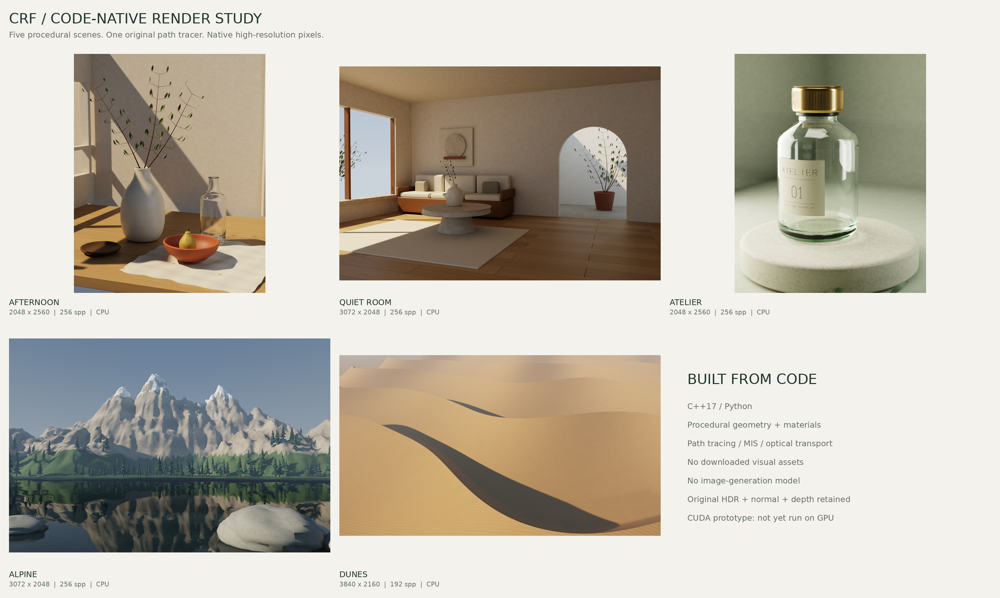

# Gaussian World 研究与完整实验交接

**日期：2026-11-23（北京时间）。这是 CRF 现有工程的研究交接，不是新的产品版本发布。**

从 [Codex 接手任务](CODEX_HANDOFF.md) 开始。这里保存本会话从原始计划、CPU 图片、CUDA 编译，到 Gaussian 技术调研和夹具准备的完整技术记录。它是可迁移组件与对照实验的来源；应用仍在 [`../../editor/`](../../editor/)，唯一活动任务账本仍是 [`../../plans/CRF_Integrated_Execution_Plan.json`](../../plans/CRF_Integrated_Execution_Plan.json)。

## 当前事实

| 内容 | 状态 |
| --- | --- |
| 自写 C++ CPU 路径追踪器及五类高清样片 | 已执行，有源码、参数、日志、哈希与预览 |
| CUDA 软件 BVH 原型 | 本地 NVCC 13.0.88 / sm_120 交叉编译及链接通过；GPU 未运行 |
| Gaussian 需求与技术研究 | 完整报告、过程研究笔记及一手来源已归档 |
| 120 相机 × 3 灯光 = 360 场景定义 | 已生成并完成解析相机/哈希检查；没有对应渲染图 |
| gsplat / NHT / 物理混合 / 光照缓存 | 候选路线；尚无本实验训练器、权重或 GPU 结果 |
| 与现有编辑器集成 | 尚未实施；这里的 C++ 实验不代表现有 GUI/Harness/Kernel 已升级 |

历史报告文件名中的 `v0.1/v0.2` 是**独立实验与研究修订号**。它不改变 CRF 产品版本、quality12/quality13 合同或已有验收状态。研究提案也不新增数学域、核心 DSL 关键词或已验证 claim。

## 阅读入口

1. [Codex 接手任务与可执行命令](CODEX_HANDOFF.md)
2. [完整工作记录与决策](WORK_LOG.md)
3. [研究报告：Gaussian 技术升级](gaussian_upgrade_research/CRF_Gaussian_World_v0.2_Research.md)
4. [证据索引及原始记录勘误](EVIDENCE_INDEX.md)
5. [大图/HDR/场景制品索引](ARTIFACTS.md)
6. [CPU 实验专项审阅](records/LEGACY_REVIEW.md) / [Gaussian 专项审阅](records/GAUSSIAN_REVIEW.md)
7. [机器状态清单](STATUS.json)

`gaussian_upgrade_research/notes_*.md` 是调研过程笔记。路线字母、初期优先级及预算建议可能不同；最终解释以研究报告与本交接为准。特别是工程笔记曾优先讨论照片重建，当前实验默认仍是程序生成数据；它不覆盖主工程已经允许的、另有来源合同的照片观察任务。

过程笔记保留原始检索编号以便追溯；这些编号在 GitHub 不解析，阅读和后续核查请使用同段的一手来源 URL。

## 本次五张 CPU 样片

这些图不是 Gaussian 输出，也不是 GPU 输出。原生 PNG 与未滤波 HDR 已另外交付；Git 收录预览、原始参数、源程序、日志和摘要。见 [ARTIFACTS.md](ARTIFACTS.md) 获取具体记录。

## 仓库与接手分支

- 仓库：`VIONWILLIAMS/complete-representation-functions`
- 本次交接分支：`codex/gaussian-world-handoff-20261123`
- 基于 `crf-gpu96-development` 的 `c2b759b9d9d0ee56ccef7a47dbe540f80c07d952`
- 主应用固定源码检查点：`55103cc7399cef3bb5eb7d9e7875f3785dedd9cd`，沿用既有入口解释其能力范围。

接手时使用包含本交接提交的分支。合入前不能只 checkout 原开发分支就假定这些新文件已经存在。本次不启动 Codex 云任务，也不宣称新 GPU 已连接。
