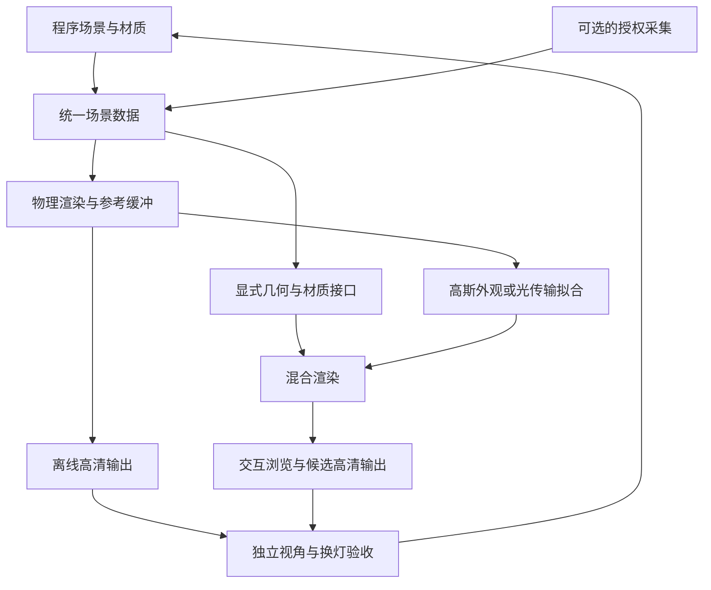

# CRF v0.2：高斯世界与物理渲染升级研究

**研究截止：2026-11-23。项目目标：用可追溯代码构建具有摄影真实感、能换视角并可解释其光照的高清图景。**

本文区分已核实的公开技术、针对项目的工程判断，以及尚待 GPU 验证的研究假设。本轮完成调研、架构设计和实验准备；没有完成高斯训练、远端 GPU 部署或新的高斯成图。此前五张样片仍是 CPU 路径追踪结果。

## 1. 决策摘要

推荐升级为：**程序场景与物理材质作为主数据，GPU 路径追踪提供可检查的参考，高斯表示负责快速浏览与受控的外观/光照近似；最终用独立视角、独立光照和原生像素裁剪验收。**

这次升级的重点有四项：

1. 补足真实感的来源：形体、微结构、材料、光照和相机。现有山体、植物和织物的简化，不能靠更换表示或增加采样消除。
2. 引入可测量的 Gaussian 分支：从已知几何、相机和自生成多视角图像开始，先验证固定光照下的新视角与交互显示。
3. 研究更有价值的混合方式：在显式表面上计算物理着色，用高斯缓存部分入射光/光传输；玻璃、镜面、水面和关键接触区域保留明确的光线路径。
4. 将真实性拆开验收：摄影观感、像素参考误差、空间几何、换灯效果、连续运动、复现与算力成本分别给证据。

默认继续沿用原计划的内容来源：**程序生成几何和材质，不引入外部照片贴图、现成三维资产或预训练生成模型。** 每个场景单独训练的高斯参数或小型外观网络，应明确登记为学习得到的表示；它们可以只拟合本项目生成的数据，因而不必引入扩散模型。真实采集和世界生成模型是另外两条输入路线，本文完整比较，但没有默认为当前项目启用。

## 2. 用通俗语言理解“高斯世界”

传统网格像把物体搭成很多小三角片。3D Gaussian Splatting 则把场景表示成许多带位置、形状、透明度和颜色信息的小椭球。换一个相机位置，把这些椭球投影到屏幕，按可见关系混合，就得到图像。通过不断与输入图像比较，可以调整这些参数，让新视角更像原场景。[S01][S02]

关键区别是：普通高斯通常记住“物体在采集时看起来是什么颜色”。一块本来白色但被阴影遮住的墙，可能被拟合成较暗的外观。要把太阳移到另一侧，必须另行解决材质、灯光和遮挡，而不能只旋转一盏虚拟灯。[S13]

因此应把三种能力分开：

| 能力 | 通俗解释 | 主要技术 |
| --- | --- | --- |
| 外观重现 | 从更多角度看起来像拍摄时的场景 | 3DGS、抗混叠、NHT、相机成像校正 |
| 几何正确 | 表面在哪里、厚度多大、前后遮挡是否正确 | 已知程序网格、2DGS、几何约束或独立测量 |
| 光学可编辑 | 换灯、换材质、移动物体后，高光和阴影正确更新 | PBR、可见性、重光照表示、光线追踪、缓存失效 |

“GaussianWorld”还存在一个正式同名研究：CVPR 2025 的工作主要做自动驾驶的流式三维占据预测，研究场景随时间怎样演化，并不是照片级图景生成引擎。本方案使用“高斯世界”的广义含义，指能被渲染、浏览和编辑的高斯场景系统。[S15]

## 3. 从公开技术和应用提炼出的需求

以下是资料驱动的需求归纳，不是已经进行过用户访谈的市场调查。Niantic Spatial 的重光照测试强调保留同一场景的几何、碰撞和语义，同时产生不同照明；NuRec 的公开工作流强调真实传感器数据、场景导出和仿真；世界生成产品强调从有限输入扩展可探索空间。这些需求有交集，但不能用同一张好看的截图证明全部完成。[S27][S28][S21]

| 需求 | 对当前项目的具体要求 | 第一轮验收方式 |
| --- | --- | --- |
| 放大后仍有可信细节 | 木纤维、陶瓷粗糙度、布料交织、边缘倒角具有合理尺度 | 原生分辨率 100% 裁剪，记录程序参数与像素覆盖 |
| 换视角不穿帮 | 轮廓、遮挡、反射、细杆和叶片连续 | 固定绕行路径与连续角度留出测试 |
| 可以修改场景 | 材质、灯光、几何和相机是独立参数 | 一次只改一个参数，检查相关与不相关区域 |
| 玻璃、水、金属可信 | 有厚度、法线、折射率、反射和吸收，困难光路有足够采样 | 小型光学夹具与独立参考渲染 |
| 高清输出和快速操作 | 导航预览与最终高质量输出各有明确模式 | 1K/2K 预览、原生 4K 最终图分别测质量与延迟 |
| 输出有依据 | 每块内容都能追溯到程序、观测或模型补全 | 输入清单、场景版本、代码版本、模型与输出哈希 |
| 能部署和迭代 | 工具链、数据格式、依赖和错误状态明确 | 设备实测、版本锁、检查点恢复与重载复现 |

### “像素级真实”需要三个独立定义

**原生像素细节**：例如输出 3840×2160，纹理和几何实际参与该分辨率的计算；放大低分辨率图不等于增加信息。

**摄影真实感**：在正常观看和局部放大时，形体、材质、光照、镜头与微小不规则都具有可信的联合表现。这需要盲评和局部失真检查。

**与真实观测逐像素一致**：必须有同一场景、相机、光照、曝光与颜色处理的真实参考。没有这类参考，虚构场景不能声称与现实逐像素一致。与自家渲染器吻合，只能证明表示转换自洽；独立物理渲染器可检查算法，仍不是现实摄影真值。

## 4. 现有项目审阅：哪些能保留，哪些必须升级

审阅依据：原 v0.1 计划、现有实现报告，以及 `crf_render/src/renderer.cpp`。本轮只读审阅，没有覆盖已交付项目。CPU 源码 SHA-256：`b016786233f2360cc5fe419f8d9e58d278cd7ac20d8f6054763dfa0d0db4dc4c`。

### 已有基础

已有程序化场景、网格/球体、BVH、基本 PBR 材质、CPU 路径追踪、线性 HDR 和法线/深度等辅助输出。CUDA 原型曾用本机 NVCC 13.0.88 对 `sm_120` 完成编译与链接，但 GPU 未执行，目标 CUDA 12.8 环境尚未验证。它适合保留为可控实验基础。

### 升级前必须正视的限制

| 当前情况 | 对升级的影响 | 处理策略 |
| --- | --- | --- |
| 植被、地形、布料与木纹结构简化 | 蒸馏成高斯后仍保留这些简化 | 优先补程序资产与多尺度微结构 |
| RGB 光输运、简化介质状态 | 嵌套玻璃/液体等情况不足以当可靠参考 | 增加介质栈、专项能量/折射检查和独立参考 |
| 直连采样使用二值遮挡 | 透射阴影、困难焦散可能难采样 | 明确透明可见性策略，改积分/采样，不只消除亮点 |
| 雾为相机距离混色近似 | 不代表真实体积散射 | 后续独立体积积分模块 |
| 显示 PNG 使用记录在案的传统滤波；静物与山水另采用亮点抑制 | 不能直接当作物理光照学习的真值 | 保存未改动的原始 HDR，区分训练目标、显示变换和参考噪声 |
| 没有完整 diffuse/specular/direct/indirect 分量 | 无法直接复现分量监督的可编辑反射方法 | 先实现并检查 AOV 分解，再启动该研究分支 |

### 发现的 AOV 接口陷阱

旧 `depth` 是归一化相机射线上的距离 **t**，并非相机坐标的 **Z**；旧 `normal` 是世界空间、朝向观察侧的法线，编码为 `0.5*n+0.5`；旧 `albedo` 对金属和玻璃并不统一表示漫反射率，玻璃参数涉及 Beer 透射色。直接把这些通道交给新框架会产生不易察觉的监督错误。

v0.2 必须显式定义：世界单位、坐标轴、相机变换方向、像素中心、Z 深度/射线距离、几何法线/着色法线、法线编码、各材质参数的物理含义。现有程序场景的旧任意单位不能自动称为米；新标定夹具明确采用米制。

## 5. 三条输入路线及选择

| 路线 | 信息来源 | 最擅长的目标 | 对当前项目的决策 |
| --- | --- | --- | --- |
| A. 程序世界 | 自有几何、材质、灯光、相机及计算结果 | 内容可控、来源清楚、物理实验、原创场景 | **默认主线**；继续提升资产真实度，再增加高斯表示 |
| B. 现实重建 | 有授权的多视角照片/视频，必要时深度与光照采集 | 复现一个真实存在的地方或物体 | 若目标转为复刻现实，通常应优先研究；需要采集输入 |
| C. 生成世界 | 预训练模型补充内容和不可见区域 | 快速创造丰富、可探索的场景 | 可选研究分支；输出要标明生成来源和不确定区域 |

这三条路线可以共享场景格式与渲染器，输入依据和质量含义必须分别记录。尤其不能把程序图输入世界模型后得到的细节，仍全部归因于自有程序建模。

## 6. 关键技术选型

优先级表示对本项目的投入顺序，并非论文质量排名。

| 技术 | 已核实的主要作用 | 重要边界 | 决策 |
| --- | --- | --- | --- |
| 3DGS / gsplat | 可微高斯光栅化与新视角外观拟合 [S01][S02] | 固定光照外观不等于独立物理材料 | **P0 基线**，优先 gsplat |
| Mip-Splatting | 3D 频率约束和 2D 过滤，缓解尺度变化伪影 [S03] | gsplat 的 `antialiased` 开关只对应相关屏幕补偿，不能代表完整 Mip 方法 | **P0 抗混叠对照** |
| 2DGS | 有方向的表面圆盘与几何一致性约束 [S04] | 不自动解决重光照；已有程序网格不必先丢弃再重建 | **P1 表面对照** |
| 3DGUT / 3DGRT / 3DGRUT | 畸变相机、二次射线与混合光栅/追踪 [S05][S06] | 支持反射查询，不等于从照片恢复完整 BRDF；需要目标设备验证 | **P1 混合后端候选** |
| Editable Gaussian Reflections | 分离漫反射/镜面分量，用路径追踪支持可编辑反射 [S07] | 主要证据来自合成真值缓冲；真实先验和实现仍有限 | **P1 高价值实验** |
| PRTGS / PRTGaussian | 预计算光传输，研究高斯重光照 [S08][S09] | 基底频率、固定几何、光照覆盖和预计算成本有边界 | **P1 限定光照实验** |
| 空间—方向高斯光照场 | 用空间高斯与方向表示缓存入射辐亮度；2026 工作给出实例 [S10] | 静态场景近似，细小阴影与时域处理仍有问题；代码可用性本轮未确认 | **P1 研究方向** |
| Neural Harmonic Textures | 提高每个图元的高频外观表达；2026 年已有 3DGRUT 集成 [S11][S06] | 需拟合数据和小网络；不自动增加真实几何或独立材料 | **P1 细节对照** |
| PPISP | 处理曝光、暗角、颜色和相机响应差异 [S12] | 修正成像差异，不等于换了真实场景灯光 | **照片路线优先**；程序固定相机可先关闭 |
| Relightable 3D Gaussian | 法线、BRDF、入射光与可见性分解 [S13] | 单一光照反演有歧义，旧工程环境需移植 | **P1 参考/对照** |
| TRON | 2026 年把 PBR 高斯与单步神经渲染结合 [S14] | 使用扩散先验；项目页代码仍标 Coming Soon；不满足默认输入约束 | **P2 前沿观察** |
| 4D-GS / PhysGaussian | 时间形变、动态显示或力学模拟 [S25][S26] | 力学正确与光学真实是独立问题 | **静态链路稳定后再做** |

### 2026 年世界生成方向的意义

HY-World 2.0 已有世界生成与重建两个入口，生成链包括全景、扩展、几何准备和高斯优化；Atlas 的官方说明采用多模态自回归扩散架构。它们表明“生成内容”和“持久三维表示”正在结合，但不可见区域仍可能是模型想象。[S20][S21]

VGGT-Ω 是几何前端候选，SAM 3D Objects 是物体补全候选，WonderWorld 提供分层扩展思路；它们各自解决输入不完整的问题。我们的程序场景已知相机和几何，第一阶段不需要再用这些模型估计同样的信息。[S22][S23][S24]

## 7. v0.2 架构

### 7.1 主数据：Scene IR

主数据包含对象 ID、程序与随机种子、显式网格/曲线/体积、材质类型与参数、灯光、相机和单位。不同表示只是该主数据的派生产物。原始资产、相机、光照与成像变换各有版本号和哈希。

对每个区域登记其最终渲染方式：显式 PBR、高斯辐射缓存或实验光传输缓存。避免同一个表面既作为已带光照的高斯颜色，又作为受光表面重复计入能量。

### 7.2 参考数据：物理渲染输出

先导出固定相机的线性 HDR、有效像素 mask、Z 深度、射线距离、几何/着色法线和 material/object ID。再按阶段增加漫反射反射率、金属 F0、粗糙度、IOR、吸收系数以及直接/间接、漫反射/镜面分量。新增通道需要能量重构检查，不能只是把现有 `albedo` 改名。

高斯外观基线可以拟合固定显影的 RGB，但其表示域必须标为显示 RGB。涉及物理合成的分支必须统一线性颜色和曝光，不能把 sRGB、tone-mapped 颜色直接当作线性辐亮度。

### 7.3 Gaussian 分支

从已知表面按面积和细节采样初始化中心、尺度、朝向与对象归属；先锁定一部分几何做外观拟合，再与允许调整几何的方案比较。训练只使用训练视角，验证视角选参数，测试视角最后评价。

第一版使用简单可重现基线。NHT、2DGS、额外密化策略和成像补偿逐项加入，每次只改变一个关键因素。相机畸变并非当前程序夹具的问题，3DGUT 的畸变能力无需抢在基础接口前面实现。

### 7.4 两种输出模式

**交互模式**以构图、相机导航和参数预览为目的，允许有记录的近似。**最终模式**以像素质量为目的，优先经过验证的物理路径追踪，或在相应测试范围内通过验收的混合路径。两种模式共享主数据和质量报告。

固定光照高斯缓存的 key 至少包括几何、材质、光照、成像域、训练数据和表示版本。改变这些条件时缓存必须失效或重建。高斯不会因为相机能移动就自动对任意物体/光照编辑有效。

## 8. 值得验证的新组合路线

这些是本项目的工程研究假设，已有相关论文基础；不声称为全球首次提出的方法。

### H1：利用程序真值，减少不必要的逆向猜测

程序场景知道表面、法线、材料与灯在哪里。可以直接监督表面约束与反射分量，专门检验高斯近似的误差。Editable Gaussian Reflections 主要使用合成真值的实验条件，与这一优势相符。[S07]

**最小验证**：一面镜子、一个哑光物体、一个粗糙金属物体；留出视角和粗糙度编辑。比较普通外观高斯、分量监督表示与路径追踪参考。

**失败判据**：训练视角好看，但换视角或移动反射物时出现镜后虚假结构、旧反射残留，或错误能量。

### H2：让高斯存部分光照信息，保留真实表面着色

常规外观高斯近似最终颜色。另一种路线是在空间和方向上近似入射光，再用显式材料求出表面颜色。2026 年空间—方向高斯研究已经展示这种思路；PRT 系列则提供固定几何下的光传输预计算基础。[S08][S09][S10]

对本项目，建议先缓存平滑的间接照明，把硬阴影、尖锐反射和透射交给显式采样。这样更容易限制误差来源。**固定灯光的入射光缓存**与**支持灯光基底变化的传输缓存**是不同产品，必须分开实现和命名。

**最小验证**：静态室内场景。先固定灯光，再测试限定的低频环境光基底变化；更换几何或影响全局反射的材质时重算缓存。

**失败判据**：细阴影消失、漏光、低粗糙度反射过宽，或在超出基底范围的光照下仍被错误标为有效。

### H3：几何复杂度与细节表达分开扩展

高斯数量增加并非唯一的细节来源。NHT 提供增强每个图元内部外观表达的路线。[S11] 我们可以在相同高斯预算下，比较普通 SH 与更丰富的外观表示，观察织物、木纹和细文字是否改善。

**最小验证**：相同程序纹理、相机、图元数和训练预算，两个种子；对未训练视角、不同焦距和分辨率逐项比较。

**失败判据**：训练图更锐，但新视角出现纹理漂移；用外观拟合掩盖错误几何；在近景产生未受监督的高频伪纹理。

### H4：按真实感缺陷分配 GPU 工作

先区分几何/材质错误、采样方差、表示误差和成像误差，再分配资源：几何问题改建模；噪声问题增加合适采样；高斯误差增加相关区域的表示能力；曝光问题改成像模型。不能用一个“继续训练”按钮处理所有错误。

新增的区域分配逻辑先做离线诊断和有限重渲染，不宣称已具备自主闭环优化。

## 9. GPU 接入后的实验矩阵

下表是待执行计划；耗时上限是预算，不是速度预测。详细机器可读计划见实验包 `scaffold/config/experiment_plan.json`。它是实验规格，不是已经实现的训练调度器。

| 实验 | 对照组与改动 | 需要的证据 | 进入下一步的条件 |
| --- | --- | --- | --- |
| E0 环境与内核 | 目标机前向、反向、保存、恢复；旧 CPU/GPU 小场景对照 | 版本、设备、编译日志、数值、显存 | 真正执行成功，不能只看编译或 import |
| E1 物理参考 | 米制标定夹具与独立解析/渲染参考 | 法线/深度/曝光/材料语义、HDR 收敛 | 参考有效，新增 AOV 定义无歧义 |
| E2 高斯基线 | 同一夹具 96/12/12 训练/验证/测试视角 | 留出误差、几何偏差、连续路径、训练成本 | 训练稳定、无测试泄漏，外观与几何失败可解释 |
| E3 尺度与细节 | 基线 vs 抗混叠；随后 SH vs NHT，各自独立比较 | 近远/焦距/分辨率变化，纹理裁剪 | 质量收益能在未训练视角重现 |
| E4 表面与反射 | 3DGS vs 表面约束；显式 PBR 与高斯混合 | 玻璃厚度、反射、遮挡、跨接口边界 | 不重复计能量，不产生旧高光残留 |
| E5a 固定灯光缓存 | 路径追踪 vs 入射光近似 | 固定灯光下的新视角；改灯后的失效和重建成本 | 重建后结果另列，不计作零重算跨光照泛化 |
| E5b 光传输与换灯 | 冻结外观高斯 vs 限定基底的 PRT | 专用环境光夹具的 V、L、VL；当前三组面积光不能直接替代 | 测试 RGB 不重新拟合，灯光位于声明的基底/适用域 |
| E6 多题材交付 | 产品、室内、自然局部；最后才扩大山水世界 | 原生 4K、线性 HDR、AOV、100% 裁剪、路径视频 | 逐题材通过，失败项随结果一起交付 |

### 数据划分

新标定夹具准备 120 个固定相机，按连续角度区间留出，而非从相邻视频帧随机抽样。基准设置为 96 train、12 validation、12 test。同一相机在不同照明下复用相同 view ID 和划分；另外冻结光照划分。

- **V**：未训练视角、训练光照，测新视角。
- **L**：已知参考视角、未训练光照，测换灯。
- **VL**：未训练视角与未训练光照同时变化。

验证集可用于选配置；测试 RGB 不参与表示、曝光或颜色校正拟合。全部角度留出仍然属于该夹具的覆盖域测试，不能代替任意外推视角。

### 质量指标

| 层面 | 记录方式 | 判读边界 |
| --- | --- | --- |
| 数值正确 | NaN/Inf、解析能量检查、参考采样收敛 | 没有异常不等于物理模型完整 |
| 同视角外观 | 固定颜色域 PSNR/SSIM，另报线性 HDR 误差；LPIPS 可选 | 不折算为真实度百分比；LPIPS 需单独登记评价网络 [S19] |
| 几何 | 轮廓、Z 深度、法线，与程序真值或独立测量比较 | 透明/镜面区域单独处理，不能套不透明深度指标 |
| 细节 | 预选关键区域的原生像素裁剪和误差图 | 同时报全图、前景、最差视角，避免只挑成功区域 |
| 连续性 | 固定路径回放，检查浮点、跳变、闪烁、遮挡后再出现 | 无光流真值时不把帧间差异直接称为闪烁误差 |
| 编辑 | 灯光、材质、对象移动分别测试 | 普通点编辑不等于阴影和间接光正确更新 |

建议先建立稳定基线，再冻结回归报警线，例如均值 PSNR 下降超过 0.2 dB、SSIM 下降超过 0.005 或 LPIPS 上升超过 0.01 时触发审查。这些只是工程建议，应根据两个种子的波动调整，不能当通用照片级标准。画面质量至少还需同条件盲评与局部失真审查。

当前夹具的三组光源是有限距离面积光。改变它们的位置可测试显式物理光照的编辑，但不能直接套用只支持远场低频环境光的 PRT。E5b 必须另建光照基底、采样和未见组合协议；这种数据尚未生成。物理几何和材料已知、允许计算传输的条件，也必须与仅输入照片的逆向重光照方法分开报告。

## 10. 算力与部署

用户此前截图中的 96GB 显存信息仍需在下一台实际设备上核验。新工具先读取设备名、显存、驱动、NVCC、Python 与可选 PyTorch 信息，不安装依赖或启动压力测试。

实施策略：一个训练任务起步，先在 512 级图像做数百步前后向与保存恢复，再到 1K/2K；4K 用于最终质量验证，不把所有方法都直接放在最大分辨率上试。

若确认独占单卡且有相应可用显存，首轮将可用显存的 70% 设为建议软预算，为密化、排序、导出与其他非 PyTorch 分配留余量。预算由实测修订；这里没有承诺 96GB 设备的 FPS、训练耗时或模型容量。

建议首轮诊断与基线总上限为 2 GPU 小时，两个升级配置各两个种子的消融总上限为 6 GPU 小时；换灯研究另设阶段预算。这些是将来可配置的停止条件，本轮没有产生这些 GPU 工作量。先用短测实测吞吐再安排后续，预算到期保存状态。

显存账面示例：SH degree 3、FP32 的普通 RGB 高斯含 59 个标量参数，约 236 字节；加梯度及 Adam 两个状态约 944 字节/高斯。这没有包括投影、排序、图像、临时缓冲与框架分配，所以不能直接按此除出“96GB 可训练多少高斯”。

速度比较需记录加载/训练/纯渲染/导出时间，固定相机路径与分辨率，预热后至少三次重复，报告中位延迟与 P95 延迟。对同一质量要求，高斯训练与教师视图生成的成本只有在足够多次复用后才可能摊平；单张图片不一定因此更便宜。

### 版本选择

截至研究日，gsplat README 将 v1.6.0 描述为 v1.5.3 之后的 main 变更，且提示尚未上 PyPI；不能把 main 文档功能当作任意已安装版本都有。3DGRUT README 已列 2026 年 NHT 与 PPISP 进展。[S02][S06]

应在目标 GPU 上选定并锁定实际通过编译与前后向检查的 commit。新建隔离环境，不把旧 CUDA 原型编译通过当作第三方 CUDA 扩展已验证。下载数据、权重或依赖前核对磁盘预算；此前截图中的磁盘规模可能比显存更早成为约束。

## 11. 可选现实重建与生成路线的输入条件

### 现实采集

如果要复刻真实桌面或房间，建议从一个静态场景开始：约 120–200 张清晰候选照片，另拍独立测试视角；这是采集预算，不是成功保证。固定焦段、对焦、曝光与白平衡，多高度移动相机产生视差；保留 RAW、EXIF、灰卡/标尺和照明记录。COLMAP 官方文档支持重叠、视差、共享内参与镜头模型选择的重要性。[S16]

处理路线可为 COLMAP → gsplat/Splatfacto → 固定灯光新视角基线；PPISP 用于真实成像变化。换灯需要额外的多光照/材质证据，OpenIllumination 可作为具有相机、照明与 mask 的外部评测候选，是否使用另登记为外部数据。[S17][S12][S18]

### 生成世界

HY-World 2.0、Atlas、SAM 3D Objects 和 WonderWorld 能提供不同粒度的生成/补全入口，但生成背面与未观测空间应标记为推断。即便最终导出了 Gaussian PLY，材质、碰撞和尺度也不能免于验证。[S20][S21][S23][S24]

## 12. 依赖许可与集成取舍

| 组件 | 本轮核实的集成信息 | 项目处理 |
| --- | --- | --- |
| gsplat、3DGRUT、PPISP | 主仓库采用 Apache-2.0，第三方组件另有归属 | 优先工程候选，锁版本及 notices |
| 原版 INRIA 3DGS 及多个派生研究实现 | 研究/评估的非商业限制 | 方法可研究；不默认把整仓代码并入可分发主工程 |
| Editable Gaussian Reflections | 新增代码 MIT，仓库明确混合其他组件许可 | 按文件与依赖核对，不能把整体称纯 MIT |
| HY-World 2.0 | 专用社区许可，代码/权重与第三方条件需分别检查 | 可选模型分支，不默认导入或用输出训练其他模型 |
| VGGT / VGGT-Ω | 不同代码与 checkpoint 的许可不同 | 记录准确版本，不能沿用另一版本的商用判断 |

许可事实来自仓库原文，和图像画质是不同的选型因素。公开下载、开放网页演示与允许产品再分发不是同一件事。详细来源见后文许可链接；本文没有使用这些受限研究仓库的代码实现新工具。

## 13. 实施顺序与本轮交付状态

**第一步：接口与参考。** 用新标定夹具确认坐标、深度、颜色、材质参数；校验旧 GPU 内核，补分量 AOV 与独立参考。先处理真实感来源和物理错误。

**第二步：固定光照 Gaussian 基线。** 用自生成数据完成真实训练/保存/恢复/留出视角评价，加入抗混叠，获得质量与速度曲线。

**第三步：两条有目的的增强。** 一条研究 NHT 的细节表达，一条研究显式 PBR 与高斯光照/反射混合；分别用消融实验决定是否保留。

**第四步：多题材高清结果。** 产品、室内和自然局部先行；复杂大山水和动态世界后置。每次交付包含原生图、HDR、关键 AOV、局部裁剪、路径回放与可复现记录。

本轮已运行设备信息采集、夹具生成及解析相机一致性检查。设备证据在 `scaffold/validation/preflight_validation.json`，夹具证据在 `scaffold/fixtures/procedural_v1/validation.json`。另外 `scaffold/ADAPTER_NOTES.md` 记录整数像素中心到 gsplat 半像素中心的主点适配。尚未渲染夹具图像，也未验证夹具成图、物理参考质量或高斯训练。

这些工具准备了下一步的输入与约定，不包含已经训练好的高斯场景，不把配置文件当作已完成的混合渲染器。本机检查中的 NVCC 不在 PATH，也不否定工作区原有独立编译工具链的存在。

## 14. 核心一手来源

以下链接在本轮检索或打开核对；论文发表年份与仓库当前状态分开记录。性能只作为作者特定实验的结果，本文未移植其 FPS 或耗时为项目承诺。

| 编号 | 来源 | 用于支持的事项 |
| --- | --- | --- |
| S01 | [3DGS，SIGGRAPH 2023][S01] | 高斯表示与新视角渲染基础 |
| S02 | [gsplat 文档及仓库][S02] | 工程后端、API、版本与抗混叠范围 |
| S03 | [Mip-Splatting，CVPR 2024][S03] | 采样尺度与频率约束 |
| S04 | [2DGS，SIGGRAPH 2024][S04] | 表面圆盘与几何约束 |
| S05 | [3DGUT，CVPR 2025][S05] | 非线性相机、混合二次射线 |
| S06 | [NVIDIA 3DGRUT 官方仓库][S06] | 3DGRT/3DGUT、2026 更新与部署条件 |
| S07 | [Editable Gaussian Reflections，SIGGRAPH Asia 2025][S07] | 分量监督、真值条件与反射编辑 |
| S08 | [PRTGS，2024 预印本][S08] | 低频环境光的传输预计算 |
| S09 | [PRTGaussian，2024 预印本][S09] | 多视角单灯数据与光传输 |
| S10 | [Frequency-Aware Spatial-Angular Gaussians，2026-08-20][S10] | 入射辐亮度的空间与方向近似 |
| S11 | [Neural Harmonic Textures，ECCV 2026][S11] | 高频外观与小网络解码 |
| S12 | [PPISP，CVPR 2026][S12] | 成像差异与新视角控制 |
| S13 | [Relightable 3D Gaussian][S13] | BRDF、光照、可见性分解 |
| S14 | [TRON，2026-06-09 预印本][S14] | 物理条件与神经渲染混合的前沿边界 |
| S15 | [GaussianWorld，CVPR 2025 对应预印本][S15] | 同名占据预测工作的真实范围 |
| S16 | [COLMAP 官方教程][S16] | 相机标定与采集要求 |
| S17 | [Nerfstudio Splatfacto][S17] | 可选端到端工程基线 |
| S18 | [OpenIllumination][S18] | 多视角、多光照评测输入 |
| S19 | [LPIPS 作者实现][S19] | 感知误差与评价网络 |
| S20 | [HY-World 2.0 官方仓库][S20] | 2026 生成与重建工作流 |
| S21 | [Atlas 官方技术介绍，2026-09-01][S21] | 世界生成与未知空间补全 |
| S22 | [VGGT-Ω 官方仓库][S22] | 2026 几何前端与 checkpoint 区别 |
| S23 | [SAM 3D Objects 官方仓库][S23] | 单图物体重建/补全 |
| S24 | [WonderWorld，CVPR 2025][S24] | 分层场景扩展 |
| S25 | [4D-GS，CVPR 2024][S25] | 动态高斯表示 |
| S26 | [PhysGaussian，CVPR 2024][S26] | 力学模拟与光学问题的区别 |
| S27 | [Niantic Spatial 重光照发布][S27] | 场景变化、几何保留、测试阶段 |
| S28 | [NVIDIA NuRec 26.10 工作原理][S28] | 现实采集、表示导出、可选扩散增强 |

部署补充：[gsplat Rasterization API](https://docs.gsplat.studio/main/apis/rasterization.html)、[gsplat 当前版本记录](https://github.com/nerfstudio-project/gsplat)、[PPISP 代码](https://github.com/nv-tlabs/ppisp)、[NHT arXiv 版本历史](https://arxiv.org/abs/2604.01204)。

许可原文：[gsplat](https://github.com/nerfstudio-project/gsplat/blob/main/LICENSE)、[3DGRUT](https://github.com/nv-tlabs/3dgrut/blob/main/LICENSE)、[PPISP](https://github.com/nv-tlabs/ppisp/blob/main/LICENSE)、[INRIA 3DGS](https://github.com/graphdeco-inria/gaussian-splatting/blob/main/LICENSE.md)、[Editable Reflections](https://github.com/graphdeco-inria/editable-gaussian-reflections/blob/main/LICENSE.txt)、[HY-World 2.0](https://github.com/Tencent-Hunyuan/HY-World-2.0/blob/main/License.txt)、[VGGT-Ω](https://github.com/facebookresearch/vggt-omega/blob/main/LICENSE)。

[S01]: https://repo-sam.inria.fr/fungraph/3d-gaussian-splatting/
[S02]: https://docs.gsplat.studio/main/
[S03]: https://niujinshuchong.github.io/mip-splatting/
[S04]: https://surfsplatting.github.io/
[S05]: https://research.nvidia.com/labs/toronto-ai/3DGUT/
[S06]: https://github.com/nv-tlabs/3dgrut
[S07]: https://repo-sam.inria.fr/nerphys/editable-gaussian-reflections/
[S08]: https://arxiv.org/abs/2408.03538
[S09]: https://arxiv.org/abs/2408.05631
[S10]: https://onlinelibrary.wiley.com/doi/10.1111/cgf.70542
[S11]: https://research.nvidia.com/labs/sil/projects/neural-harmonic-textures/
[S12]: https://research.nvidia.com/labs/sil/projects/ppisp/
[S13]: https://nju-3dv.github.io/projects/Relightable3DGaussian/
[S14]: https://research.nvidia.com/labs/sil/projects/tron/
[S15]: https://arxiv.org/abs/2412.10373
[S16]: https://colmap.github.io/tutorial.html
[S17]: https://docs.nerf.studio/nerfology/methods/splat.html
[S18]: https://oppo-us-research.github.io/OpenIllumination/
[S19]: https://github.com/richzhang/PerceptualSimilarity
[S20]: https://github.com/Tencent-Hunyuan/HY-World-2.0
[S21]: https://worldlabs.ai/blog/atlas
[S22]: https://github.com/facebookresearch/vggt-omega
[S23]: https://github.com/facebookresearch/sam-3d-objects
[S24]: https://kovenyu.com/wonderworld/
[S25]: https://guanjunwu.github.io/4dgs/
[S26]: https://xpandora.github.io/PhysGaussian/
[S27]: https://www.nianticspatial.com/blog/introducing-gaussian-splat-relighting
[S28]: https://docs.nvidia.com/nurec/archives/26.10/basics/how-nurec-works.html
